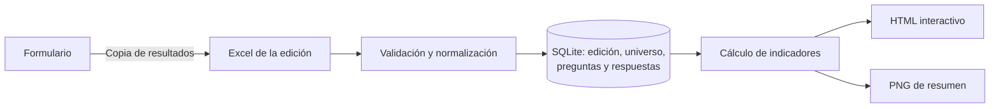
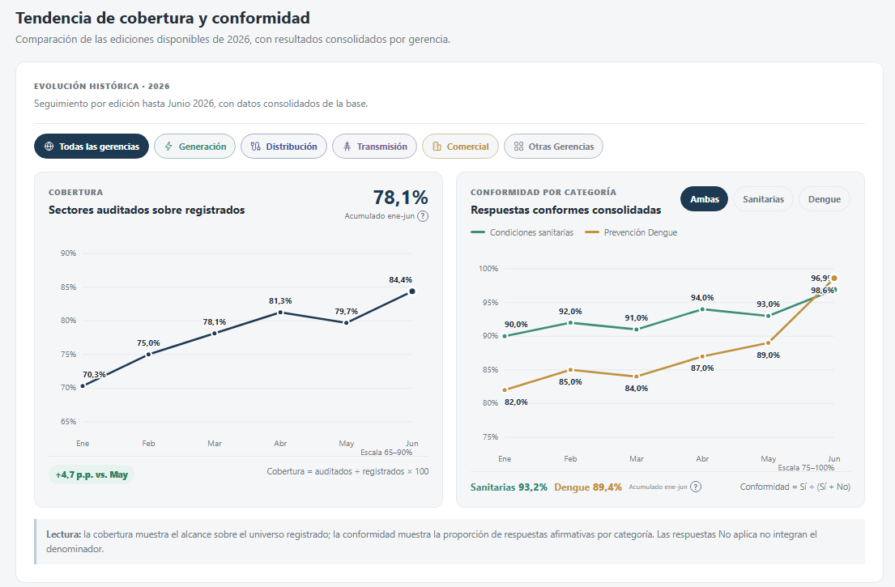

# De capturas de Excel a reportes de auditoría interactivos

**Un correo lleno de capturas podía mostrar los resultados de una auditoría, pero no permitía explorarlos.** Para consultar otro sector, entender un indicador o comparar un mes con otro, había que volver a la planilla.

Transformé ese proceso en un sistema que toma los resultados de auditorías desde Excel, los valida y conserva su contexto histórico. Con esos datos genero un **reporte HTML interactivo** para explorar los resultados y un **PNG** para compartir un resumen visual.

> Este caso describe mi trabajo en un entorno corporativo. Para proteger la información, no incluyo nombres, archivos ni resultados reales; los ejemplos numéricos son ficticios.

## Cómo se preparaba el informe

El proceso empezaba con un formulario de Google Forms. Las respuestas se copiaban y pegaban en un Excel, donde se armaban cuadros, gráficos y resultados de la auditoría. Para comunicar la edición, se tomaban capturas de esos cuadros y se pegaban en un correo.

El correo permitía compartir la información, pero el resultado era una colección de imágenes estáticas: difícil de leer con comodidad y limitada a lo que se había decidido capturar. Si quería revisar otro detalle o dar contexto a los números, la respuesta seguía estando en la planilla.

Mi primer intento de mejora fue usar Python para acomodar y pegar las imágenes en el correo. Resolví parte del trabajo de presentación, pero no el problema de fondo: el informe seguía siendo un conjunto de capturas y la experiencia de lectura seguía siendo incómoda.

## El cambio de enfoque

Ya había creado reportes HTML para otras soluciones. En una conversación, mi jefe me dijo: «Pensé que ahora mandabas todos esos archivos HTML». Esa frase me hizo replantear el informe: en lugar de seguir acomodando imágenes en el correo, podía ofrecer un reporte que se abriera en el navegador y permitiera consultar los resultados directamente.

La idea creció más allá de diseñar una página. Para generar un informe todos los meses necesitaba validar los datos, definir qué contaba como una auditoría recibida y conservar el contexto de cada edición. También quería incorporar comparaciones históricas, pero solo cuando los datos permitieran hacerlas con sentido.

## Del Excel a dos formas de consultar los resultados

| Antes | Ahora |
|---|---|
| Copiaba las respuestas del formulario al Excel y preparaba cuadros y gráficos. | Mantengo el Excel como fuente y valido su estructura y sus datos antes de cargar una edición. |
| Compartía capturas estáticas pegadas en un correo. | Genero un HTML interactivo para explorar resultados y un PNG con un resumen visual. |
| Para volver a consultar detalles o comparar períodos, tenía que recurrir a las planillas. | Conservo cada edición en SQLite y uso esos datos para generar resultados y comparaciones históricas cuando corresponden. |

En el HTML puedo recorrer los resultados de una edición, consultar desgloses y revisar qué unidades o equipos enviaron una auditoría. Según el tipo de auditoría, también puedo explorar resultados por categoría, pregunta o clasificación y consultar tendencias disponibles.

*Imagen ilustrativa: todos los sectores, cantidades y resultados mostrados son ficticios.*

El PNG cumple otro propósito: presentar un resumen visual sin tener que recorrer el detalle interactivo. Genero ambas salidas a partir de la edición almacenada en la base, no de capturas manuales de la planilla.

## Cómo llega la información al reporte

1. Parto del Excel que contiene el universo esperado y los resultados de la edición. La copia desde el formulario forma parte del proceso previo; no la presento como una integración automática.
2. Valido la estructura del archivo y los datos necesarios para identificar la edición, el universo, las preguntas y las respuestas. Normalizo los valores y aplico reglas para resolver reenvíos.
3. Guardo en SQLite una fotografía de la edición, junto con una referencia y una huella del archivo utilizado. Si recargo una edición, reemplazo su información completa dentro de una transacción.
4. Calculo los indicadores desde la base y genero el HTML y el PNG. También puedo volver a generar los reportes de una edición ya cargada.

Implementé el circuito para dos tipos de auditoría: una centrada en unidades organizativas y otra en equipos. Comparten el recorrido general, pero no necesariamente el mismo universo, cuestionario o reglas de validación.

## Las decisiones detrás de los números

### No confundir una auditoría enviada con un resultado conforme

Separé dos preguntas que podrían confundirse:

- **Cobertura:** ¿qué proporción de las unidades o equipos esperados envió una auditoría?
- **Conformidad:** entre las respuestas aplicables, ¿qué proporción fue afirmativa?

Por ejemplo, si recibo auditorías de 8 de 10 unidades, la cobertura es del 80 %. Si en esas auditorías hay 18 respuestas afirmativas y 2 negativas, la conformidad es del 90 %. Una auditoría enviada puede contener respuestas negativas; por eso, ambos indicadores cuentan cosas distintas.

Para calcular la conformidad excluyo las respuestas «No aplica». En los acumulados históricos sumo los conteos originales y vuelvo a calcular el porcentaje, en lugar de promediar los porcentajes mensuales.

### Mantener el contexto de cada edición

El universo de una auditoría puede cambiar: una unidad puede incorporarse, dejar de estar activa o cambiar de clasificación. Por eso guardo el universo correspondiente a cada edición, en lugar de reconstruir el pasado usando el catálogo actual.

También conservo las preguntas y respuestas asociadas a esa edición. Así puedo saber con qué información se calculó un resultado y mantener en el denominador a las unidades o equipos que debían participar aunque no hayan enviado una auditoría.

### Resolver los reenvíos de forma consistente

Una unidad o equipo puede enviar el formulario más de una vez. Para evitar contar esos envíos como auditorías independientes, conservo el más reciente según la fecha de envío y, como criterio adicional, el identificador del formulario. La base guarda la respuesta consolidada, no una copia separada de los reenvíos descartados.

Antes de guardar una edición, valido el archivo y sus datos. Si una recarga falla durante el reemplazo, la transacción evita dejar una edición parcialmente actualizada. Esto no elimina la necesidad de revisar los datos de origen: una respuesta válida en el formulario no garantiza por sí sola que describa correctamente la situación real.

## Comparar meses también tiene límites

Incorporé estadísticas históricas para dar contexto a los resultados, pero no asumí que todas las ediciones se pueden comparar de la misma manera. Algunas tienen errores en los datos de origen; en otras cambian la cantidad o el contenido de las preguntas.

*Imagen ilustrativa: todos los sectores, cantidades y resultados mostrados son ficticios.*

Si cambia el cuestionario, una variación en la conformidad puede deberse en parte a qué se preguntó, no solo a un cambio en las condiciones auditadas. Por eso algunas estadísticas no se incluyen cuando no hay una base suficientemente comparable, y cuando una diferencia relevante forma parte del cálculo debe explicarse en el reporte. Prefiero señalar ese límite antes que presentar una tendencia que parezca precisa pero lleve a una conclusión equivocada.

## Herramientas

| Herramienta | Para qué la utilicé |
|---|---|
| Python | Coordinar la carga, aplicar validaciones y cálculos, y generar los reportes. |
| OpenPyXL | Leer las hojas, estructuras y valores de los archivos Excel. |
| SQLite y SQL | Conservar las ediciones y su contexto histórico. |
| HTML, CSS y JavaScript | Construir el reporte interactivo para el navegador. |
| Pillow | Generar el PNG de resumen. |
| pytest | Probar reglas, cargas y generación de reportes. |

## Resultado y aprendizaje

Pasé de preparar un correo con capturas a generar un informe que permite explorar resultados y un resumen visual a partir de datos almacenados. No medí formalmente el ahorro de tiempo, así que no le atribuyo una cifra al cambio.

El aprendizaje más importante fue que mejorar un reporte no consiste solo en hacerlo más atractivo: también implica entender de dónde viene cada número, qué comparación tiene sentido y qué necesita consultar quien recibe la información. El HTML resolvió la presentación; las validaciones y el histórico le dieron una base para volver a generar y explicar esos resultados.
