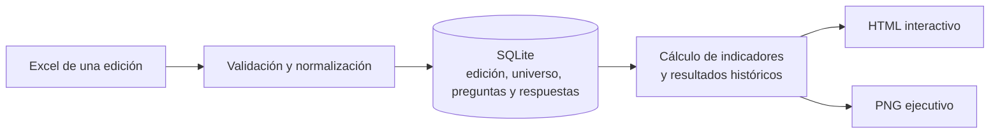

# De archivos de auditoría a reportes con contexto histórico

> **Caso de estudio:** validación de datos, modelado histórico y generación de reportes para el seguimiento de auditorías de seguridad. Los ejemplos de este documento son ficticios y no incluyen resultados productivos.

## Una pregunta que necesita contexto

¿Cuántas auditorías se realizaron y qué muestran sus resultados? Para responder no alcanza con contar las planillas recibidas. También hay que saber qué unidades o equipos debían participar, cuáles enviaron una respuesta y qué preguntas correspondían a esa edición.

Diseñé un proceso que toma archivos Excel de auditoría, valida su contenido y conserva en SQLite una representación de cada edición. A partir de esos datos genera un reporte HTML interactivo y una imagen PNG de resumen. El objetivo es que el seguimiento pueda reproducirse con reglas conocidas y que los resultados anteriores conserven el contexto con el que fueron calculados.

El sistema contempla actualmente dos tipos de auditoría: una orientada a unidades organizativas y otra a equipos. Comparten el recorrido general, pero cada una tiene su propio universo, cuestionario y reglas de validación.

## El problema

Los resultados de cada edición llegan en archivos de trabajo que contienen tanto el universo esperado como las respuestas recibidas. Si el análisis depende exclusivamente de preparar una salida sobre cada planilla, comparar ediciones y reconstruir el origen de un resultado requiere volver a recorrer esos archivos y sus particularidades.

Además, algunas situaciones necesitan una decisión explícita antes de producir indicadores:

- Una misma unidad o equipo puede enviar el formulario más de una vez.
- Los cuestionarios y las clasificaciones pueden variar entre ediciones.
- Una unidad o un equipo que debía participar puede no haber enviado una respuesta.
- Que una auditoría haya sido enviada no significa que todas sus respuestas sean conformes.
- El universo vigente puede cambiar después de una edición histórica.

La solución no intenta eliminar Excel del proceso: **cada archivo sigue siendo la fuente de una edición**. El sistema agrega una etapa de validación y una base histórica desde la cual se generan los reportes.

## El recorrido del dato

1. Una persona selecciona el tipo de auditoría y el archivo correspondiente.
2. El sistema valida el nombre y la estructura esperada del Excel, el universo, las preguntas, las fechas y las respuestas según el tipo de auditoría.
3. Las respuestas se normalizan y los reenvíos se consolidan con una regla definida. La edición validada se guarda en SQLite junto con el nombre y una huella del archivo de origen.
4. Los reportes consultan la edición almacenada, calculan sus indicadores y producen un HTML interactivo y un PNG ejecutivo.

El asistente también permite generar reportes de una edición ya cargada. Las recargas son operaciones explícitas: **reemplazan la edición completa, no agregan filas de manera incremental**, y se solicita confirmación antes de ejecutarlas.

## Decisiones que hacen confiable el seguimiento

### Conservar el universo de cada edición

El universo representa las unidades o equipos que debían ser auditados en una edición concreta. El sistema guarda una fotografía de ese universo y de su clasificación junto con las respuestas y las preguntas correspondientes.

Por ejemplo, si una edición ficticia contempla diez equipos y más adelante uno deja de estar activo, el reporte de aquella edición sigue considerando los diez equipos originales. No cambia su denominador simplemente porque el catálogo vigente haya cambiado.

Esta distinción permite que una comparación histórica conserve el contexto de cada período, en lugar de reconstruir el pasado con la organización actual.

### Validar antes de reemplazar

Los archivos tienen una estructura esperada: hojas, encabezados, preguntas y campos que el loader necesita reconocer. Si el contenido no cumple las validaciones o presenta una diferencia que no puede resolverse con las reglas previstas, la carga se rechaza en lugar de producir un resultado parcial.

Cuando se recarga una edición, el reemplazo de su información se realiza dentro de una transacción. Así, un error durante esa operación no debería dejar una edición parcialmente reemplazada. Los archivos fuente no se modifican.

### Resolver los reenvíos de forma consistente

Puede haber más de un envío para una misma unidad o equipo. Para los cálculos se conserva el más reciente según la fecha de envío y, como criterio adicional, el identificador del formulario. Los anteriores no se cuentan como auditorías adicionales ni se almacenan como respuestas consolidadas.

Esta regla hace explícita una decisión que, de otro modo, podría cambiar los indicadores según cómo se filtrara una planilla. La huella del archivo ayuda a identificar la fuente utilizada, aunque la base no conserva por separado los reenvíos descartados.

### Separar cobertura y conformidad

Los reportes responden dos preguntas diferentes:

- **Cobertura:** ¿qué proporción del universo esperado tiene una auditoría enviada?
- **Conformidad:** entre las respuestas aplicables, ¿qué proporción fue afirmativa?

En un ejemplo ficticio, si respondieron 8 de 10 unidades, la cobertura es del 80 %. Si entre las respuestas aplicables hay 18 «sí» y 2 «no», la conformidad es del 90 %. No son indicadores equivalentes: recibir una auditoría no implica que todas sus respuestas sean conformes.

Las respuestas «no aplica» se excluyen del denominador de conformidad. En los acumulados, el sistema suma los conteos originales de las ediciones incluidas y recalcula el indicador; no utiliza un promedio simple de porcentajes mensuales.

## Una salida para explorar y otra para comunicar

El **HTML interactivo** permite recorrer los resultados de la edición y consultar tendencias y desgloses. Las secciones y filtros se adaptan al tipo de auditoría: en un caso el seguimiento se organiza por unidades y clasificaciones; en el otro, por equipos, categorías y preguntas.

El **PNG ejecutivo** ofrece una salida visual más sintética. Ambos formatos se generan desde la información almacenada en SQLite, sin volver a interpretar el Excel durante la generación del reporte.

La herramienta no envía automáticamente los resultados ni reemplaza la revisión humana. El asistente permite elegir entre cargar datos, generar un reporte de una edición existente o realizar ambas operaciones; al terminar, abre el HTML para su consulta.

## Tecnologías y forma de trabajo

| Herramienta | Función en el proyecto |
|---|---|
| Python | Orquestación de la carga, validaciones, cálculos y generación de reportes. |
| OpenPyXL | Lectura de las estructuras y valores de los archivos Excel. |
| SQLite y SQL | Conservación de ediciones, universos, preguntas y respuestas históricas. |
| HTML, CSS y JavaScript | Presentación e interacción del reporte en el navegador. |
| Pillow | Generación de la imagen PNG de resumen. |
| pytest | Pruebas de conexiones, cargas, reglas y generación de reportes. |

Mi trabajo en este caso comprende el diseño del circuito de datos y del modelo histórico, la implementación de validaciones y cálculos, la generación de las salidas y la documentación de las reglas necesarias para mantenerlo. La automatización acompaña un proceso existente: no convierte por sí sola los archivos de origen en datos correctos si las reglas o la información de entrada son incompletas.

## Alcance y próximos desafíos

La solución cubre actualmente dos tipos de auditoría. La incorporación de una auditoría de seguridad locativa es un **paso futuro**: antes de integrarla será necesario comprender su fuente, universo, cuestionario y reglas para decidir qué componentes pueden compartirse y cuáles requieren tratamiento propio.

También quedan oportunidades para seguir separando cálculos, acceso a datos y presentación, y para ampliar la validación visual de las salidas. El proyecto busca hacer el seguimiento más consistente y mantenible; este caso no presenta una medición formal de ahorro de tiempo ni afirma que las fuentes hayan dejado de requerir revisión.

## Privacidad

Este caso describe decisiones y flujos de trabajo aplicados en un entorno corporativo. Se omiten nombres, rutas, archivos de origen, observaciones y resultados reales. Los ejemplos numéricos son ficticios.
