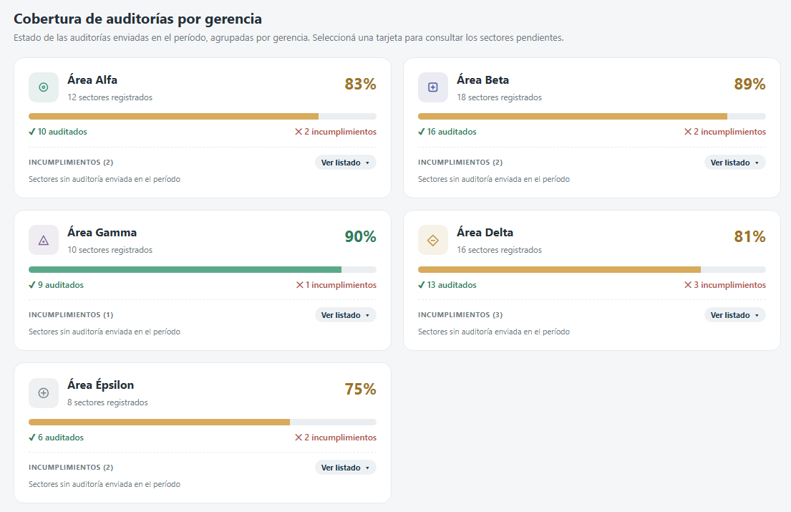
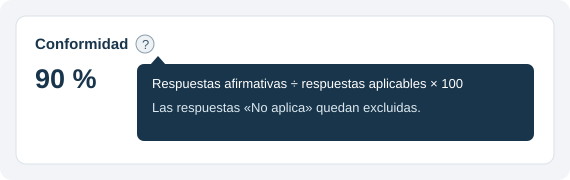
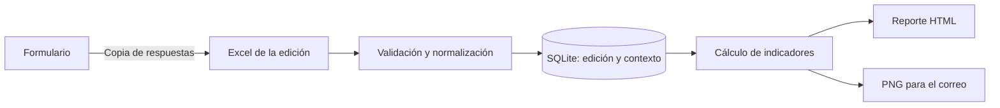

# Reportes de auditorías de seguridad

Las auditorías de seguridad permiten revisar las condiciones de distintos sectores y hacer seguimiento de sus resultados. Al terminar cada edición, el reporte busca responder dos preguntas: **qué sectores participaron** y **qué tan conformes fueron sus respuestas**. Esta información permite a gerentes, directores, jefes y auditores revisar el desempeño de cada gerencia y profundizar en los sectores y preguntas que necesiten atención.

Antes, las respuestas del formulario se copiaban a un Excel. Se preparaban cuadros y gráficos, se pegaban capturas en un correo y se adjuntaba también la planilla. Para revisar las respuestas había que abrir ese Excel con los datos en bruto, ensanchar columnas para leer las preguntas y filtrar manualmente sector por sector. Las respuestas no estaban agrupadas para facilitar esa consulta y abrir la planilla desde un celular resultaba incómodo.

Desarrollé un proceso en **Python** que valida la información y genera automáticamente un **reporte interactivo con HTML y CSS**. El reporte reúne más información que las capturas anteriores, pero la organiza con menos elementos para que se pueda interpretar más rápido. Tiene un diseño adaptable para consultarlo desde una computadora o un celular, aunque todavía hay detalles de visualización por mejorar.

> Este caso describe un proyecto realizado en un entorno corporativo. Las imágenes y cifras son ilustrativas; no se incluyen datos ni resultados reales.

## Qué permite consultar el reporte

El HTML presenta la **cobertura por gerencia** —qué proporción de los sectores esperados envió su auditoría— y la **conformidad de las respuestas**. A partir de esa vista general se puede entrar en el detalle por sector, pregunta o categoría y consultar la evolución de los resultados cuando los períodos son comparables.

*Vista ilustrativa con datos ficticios.*

Agregué ayudas breves o *tooltips* junto a algunos indicadores para explicar cálculos puntuales sin recargar la pantalla. Por ejemplo, permiten aclarar qué se incluye en el cálculo de la conformidad.

*Ilustración de la ayuda, no una captura del entorno productivo.*

El proceso también genera un **PNG para dar un pantallazo rápido en el correo**. El HTML es el reporte completo, donde se consultan los detalles.

## Cómo se genera

La copia de las respuestas desde el formulario al Excel sigue siendo manual. A partir de ese archivo, el proceso valida y normaliza los datos, guarda la edición en SQLite y genera ambas salidas. También permite regenerar los reportes de una edición ya cargada.

El circuito contempla dos tipos de auditoría: una por unidades organizativas y otra por equipos. Comparten el proceso general, pero tienen universos, cuestionarios y validaciones propios.

## Decisiones técnicas

- **Cobertura y conformidad son indicadores distintos.** La cobertura mide las auditorías recibidas sobre las esperadas; la conformidad mide las respuestas afirmativas sobre las aplicables. Las respuestas «No aplica» se excluyen de este último cálculo.
- **Cada edición conserva su contexto.** Se guardan su universo, preguntas y respuestas para no recalcular un período pasado con una estructura organizativa posterior. En los acumulados se suman los conteos originales y se vuelve a calcular el porcentaje, en lugar de promediar porcentajes mensuales.
- **Los reenvíos se consolidan.** Si un sector o equipo envió más de una respuesta, se conserva la más reciente según la fecha de envío y, como criterio adicional, el identificador del formulario.
- **La carga se valida antes de reemplazar una edición.** Una recarga reemplaza la edición completa dentro de una transacción; si falla, no debería quedar parcialmente actualizada. La validación no reemplaza la revisión de los datos de origen.
- **Las comparaciones históricas tienen límites.** Si cambian las preguntas o hay errores en el origen, una variación puede no ser comparable. El reporte limita o explica esas estadísticas según corresponda.

## Herramientas

| Herramienta | Uso |
|---|---|
| Python | Validaciones, cálculos y generación de los reportes. |
| OpenPyXL | Lectura de los archivos Excel. |
| SQLite y SQL | Almacenamiento y consulta de las ediciones. |
| HTML, CSS y JavaScript | Presentación e interacción del reporte. |
| Pillow | Generación del PNG para el correo. |
| pytest | Pruebas de cargas, reglas y reportes. |

El resultado es un reporte que reúne la información de cada edición y permite pasar de una vista general al detalle sin recorrer manualmente la planilla. No se realizó una medición formal del tiempo ahorrado.
