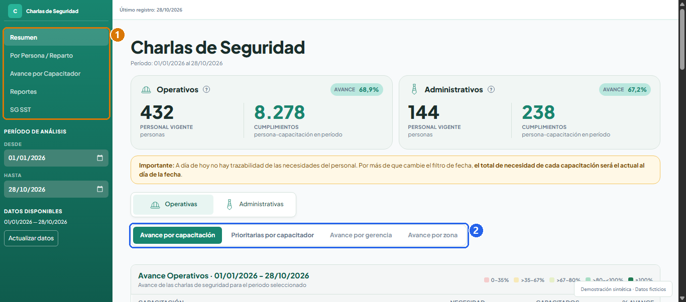
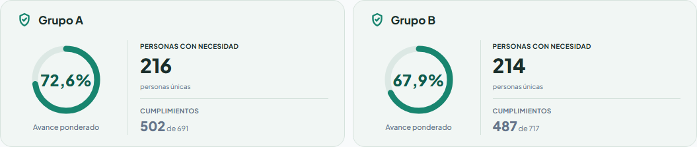
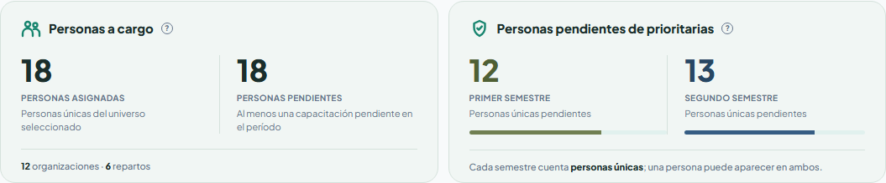
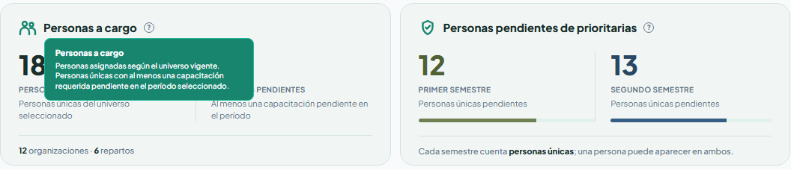
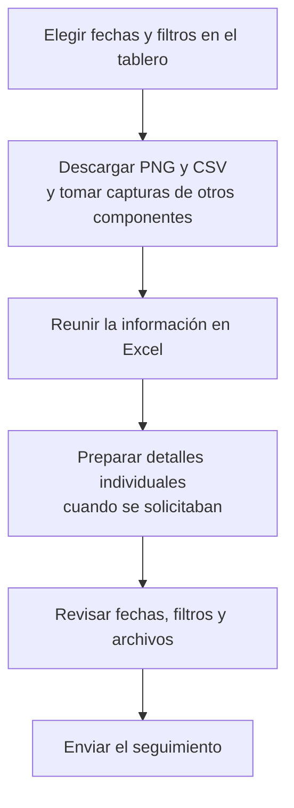
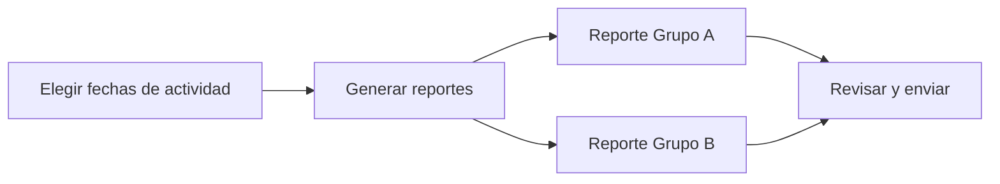
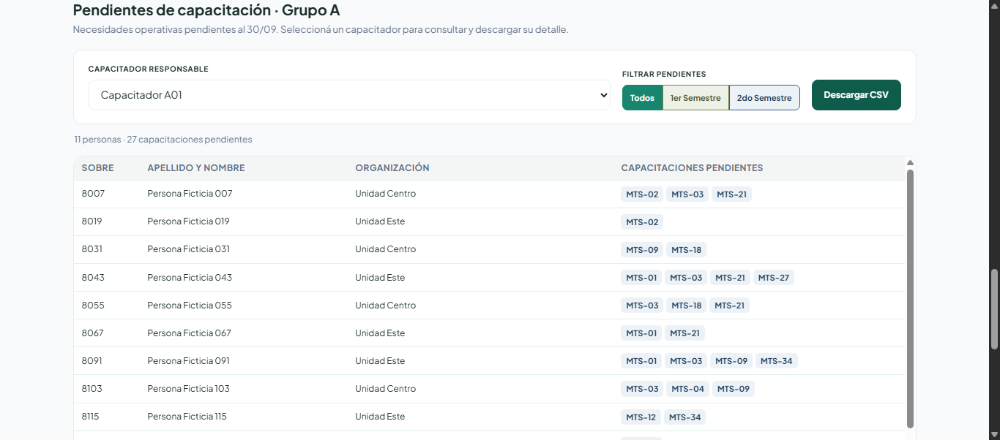
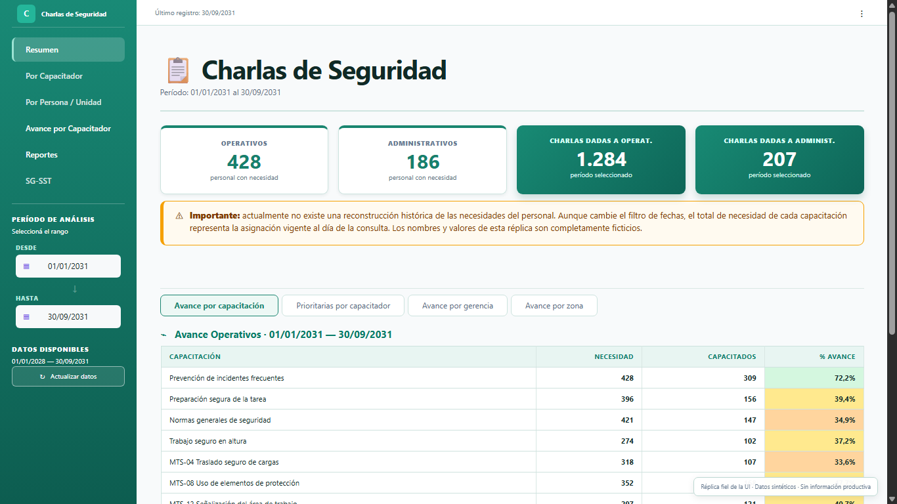
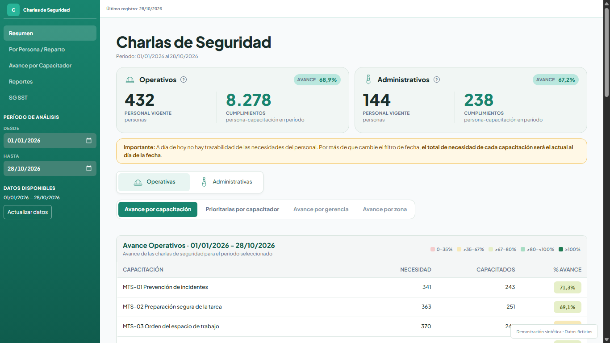
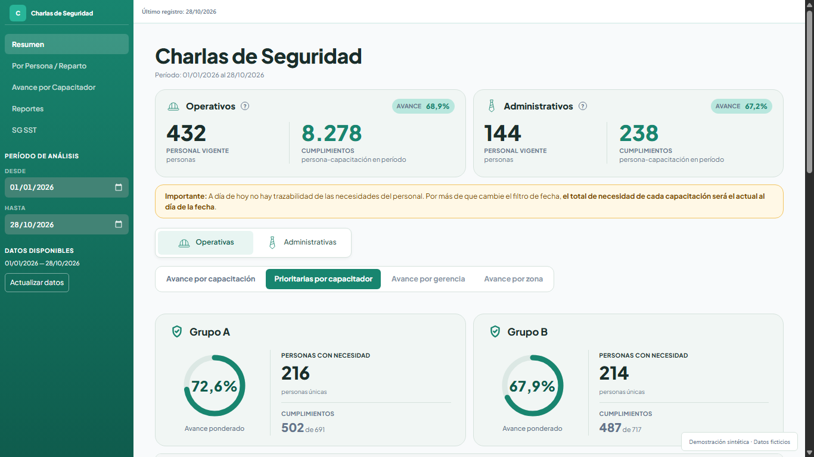

# Evolución del dashboard: navegación y reportes HTML

Esta es la actualización de un [proyecto que ya había documentado](../): un tablero para hacer seguimiento de las charlas de seguridad y saber cómo avanza el programa de capacitaciones.

La idea es poder pasar de una pregunta a una respuesta sin tener que reconstruir la información a mano. Por ejemplo:

- ¿Cuántas personas forman parte del personal operativo y cuántas del administrativo?
- ¿Cómo avanza una capacitación específica? ¿Y las capacitaciones prioritarias del programa 2026?
- ¿En qué fecha realizó una persona una capacitación?
- ¿Cuántas personas tiene pendientes de capacitar un responsable y quiénes son?
- ¿Dónde trabajan esas personas y qué temas del programa les faltan?

Las preguntas son sencillas. Lo desafiante es que las respuestas sigan teniendo sentido con el paso del tiempo, cuando las personas cambian de puesto u organización, toman una licencia o cambia su situación de alguna otra manera.

El tablero tiene incorporada toda esta lógica de negocio para acompañar esos cambios sin tener que corregir indicadores a mano cada vez que ocurre uno. Por ejemplo, cuando se actualizan los datos de una licencia o de un cambio de puesto, el tablero vuelve a calcular las métricas y las necesidades de capacitación que correspondan. Así, el objetivo es que el seguimiento siga siendo útil con el tiempo y requiera la menor intervención posible, sin depender de ajustes constantes en el backend.

Con el tiempo, el tablero fue sumando análisis útiles, pero también pantallas cada vez más largas. Además, para enviar el avance semanal a jefaturas y capacitadores había que navegar por distintas secciones, descargar planillas y gráficos, tomar capturas y reunir todo en un informe.

### Entonces, ¿qué resuelve esta actualización?

Esta actualización aborda ambos problemas: **reorganiza la navegación mejorando el UX/UI** para que sea más fácil encontrar cada consulta, y permite generar **reportes HTML interactivos** que reúnen las partes más importantes del seguimiento, cuya idea es que cada destinatario del reporte semanal pueda encontrar en un mismo archivo las respuestas que necesita.


- **[Explorar el dashboard navegable](https://jminolli-e.github.io/case-studies/capacitaciones/actualizacion/demo/dashboard-actual.html):** recorrer las pantallas y secciones disponibles en la demo.
- **[Abrir el reporte HTML interactivo](https://jminolli-e.github.io/case-studies/capacitaciones/actualizacion/demo/reporte-actual.html):** consultar indicadores, filtros y descarga CSV.
- **Versión anterior del tablero:** se conserva la [réplica anterior del dashboard](./demo/dashboard.html) como archivo fuente.

## Un poco de contexto

No todas las personas necesitan los mismos contenidos: estos dependen del puesto, las tareas y el departamento. Algunos se priorizan para concentrar el seguimiento durante una etapa del año.

Además del avance general y los pendientes, el tablero permite comparar resultados por capacitación, gerencia, zona, organización y reparto; consultar la actividad histórica de los capacitadores y la situación de una persona; y revisar la cobertura de las capacitaciones obligatorias de SG-SST.

> [!NOTE]
> **Responsable y quien dictó:** una persona puede estar asignada a un capacitador para su seguimiento y recibir una charla de otro. El tablero conserva ambos datos para distinguir la responsabilidad sobre los pendientes de la actividad efectivamente dictada.
> Para el avance del programa importa que la persona haya completado el contenido, aunque lo haya dictado otro capacitador.

## Qué cambió

| Tema | Antes | Problema | Ahora | Solución aportada |
|---|---|---|---|---|
| **Navegación** | Los indicadores, gráficos, tablas y mapas se apilaban en pantallas largas. | Para llegar a un análisis había que atravesar otros que no siempre eran relevantes. Al agregar contenido, los bloques cambiaban de posición. | Las pantallas del menú lateral se organizan en secciones con componentes relacionados. | Cada consulta tiene un lugar más predecible: primero se elige la pantalla y después el análisis puntual, sin recorrer todos los bloques anteriores. |
| **Reporte semanal** | Los coordinadores reunían PNG, capturas, CSV y planillas para preparar el seguimiento de aproximadamente 30 capacitadores. | Había que configurar fechas y filtros varias veces, comprobar que los extractos coincidieran y preparar detalles individuales. | Desde el tablero se genera un HTML para Grupo A y otro para Grupo B, con información general y detalle descargable. | El armado se automatiza y cada capacitador puede obtener sus pendientes del mismo reporte. La revisión y el envío siguen bajo control humano. |

## Navegación: de pantallas largas a secciones

### El problema de navegación anterior

El crecimiento del dashboard era útil desde el punto de vista funcional: cada nuevo gráfico, tabla o mapa respondía una consulta real. El problema era que la interfaz seguía creciendo hacia abajo. Dentro de `Resumen`, por ejemplo, podían convivir los indicadores generales, el avance por capacitación, las prioridades por capacitador, comparaciones por gerencia y zona, mapas de calor y listados operativos.

Los títulos ayudaban a separar visualmente cada bloque, pero no resolvían la navegación. Para llegar a un gráfico o mapa de calor ubicado al final había que atravesar los bloques anteriores, aunque no fueran relevantes para esa consulta.


La animación reconstruye el recorrido anterior con datos ficticios; no es una grabación del entorno productivo.

### La solución: elegir qué consultar

El menú lateral ya existía. El cambio fue organizar mejor lo que ocurría dentro de cada pantalla, en lugar de seguir agregando componentes uno debajo del otro. La navegación queda en dos niveles:

1. **Pantallas:** se eligen desde el menú lateral y representan una consulta principal. `Resumen` y `Avance por Capacitador` son dos ejemplos.
2. **Secciones:** se eligen mediante los controles horizontales dentro de cada pantalla. Permiten pasar, por ejemplo, del avance por capacitación a las prioridades por capacitador, mostrando sólo los componentes relacionados con esa consulta.



La separación no es solamente visual. Los indicadores generales de una pantalla siguen calculándose una vez, pero las consultas y transformaciones propias de cada sección esperan hasta que alguien la elija. Así se evita preparar análisis que todavía no se están consultando. Más abajo cuento cómo se resolvió en Streamlit.

### Una interfaz con más contexto y menos ruido

También me tocó dejar ir algunos componentes. Había gráficos detallados e interesantes que no se utilizaban y terminaban haciendo ruido. Aunque me había llevado trabajo construirlos, mantenerlos sólo por eso no ayudaba a quienes necesitaban encontrar una respuesta.

No se trataba únicamente de quitar cosas, sino de reunir lo que tiene sentido leer junto. Los indicadores de Grupo A y Grupo B, por ejemplo, ahora presentan el avance ponderado, las personas con necesidad y los cumplimientos dentro de un mismo contenedor por grupo. Ya no hace falta recorrer varias tarjetas para reconstruir esa relación.



Lo mismo ocurre con los indicadores de personas a cargo y pendientes prioritarios: cada bloque reúne valores, unidades y aclaraciones.



Algunas tarjetas y tablas incorporan **tooltips**, pequeñas ayudas que aparecen al pasar el cursor y explican qué representa un valor o cómo se calcula. Así se conserva el contexto sin llenar la pantalla de explicaciones permanentes.

<details>
<summary><strong>Ver un ejemplo de ayuda sobre los indicadores</strong></summary>



</details>

La navegación lateral también es más compacta. La antigua pantalla de actividad por capacitador dejó de ser independiente: su información útil se integró como `Actividad histórica` en `Avance por Capacitador`, separando lo que una persona dictó de la responsabilidad sobre las personas y contenidos que tiene asignados.

La reorganización busca reducir recorridos innecesarios y facilitar la consulta a personas con distintos niveles de familiaridad digital, sin quitar controles ni contexto útil. Al final se presenta una [comparación visual](#comparación-visual) de dos secciones.

## Reporte semanal: del armado manual a un HTML por grupo

### Cómo se preparaba el seguimiento semanal

El seguimiento está dividido entre dos coordinadores y dos grupos. Cada coordinador trabaja con aproximadamente 15 capacitadores de `Grupo A` o `Grupo B`. La separación responde a la organización operativa del programa, pero ese criterio no es necesario para comprender la solución técnica.

Preparar el seguimiento implicaba recorrer el tablero, extraer información de distintos lugares y armar el informe por fuera:



Cada material cubría una necesidad distinta:

| Material | Para qué se usaba |
|---|---|
| **PNG y capturas** | Mostrar el panorama general y comparar avances. |
| **CSV** | Identificar qué personas seguían pendientes y qué contenidos les faltaban. |
| **Excel** | Reunir y distribuir parte de la información del seguimiento. |

Como el filtro de fechas afectaba a todo el tablero, había que cambiarlo varias veces y comprobar que cada descarga correspondiera al período esperado. Un error en ese paso podía hacer que una parte del informe no coincidiera con las demás.

El proceso completo demandaba aproximadamente una hora semanal entre ambos coordinadores. Es una estimación: podía variar según la cantidad de archivos individuales solicitados y no existía una medición formal. El principal problema no era solamente el tiempo, sino también la posibilidad de aplicar fechas distintas, omitir un archivo o distribuir información que no coincidiera con el resto del paquete.

### La solución: generar, revisar y compartir

Decidí llevar ese armado al propio tablero. En lugar de reconstruir el informe a partir de extractos, manualmente o con una herramienta de IA, el sistema prepara una salida con fuentes y reglas definidas. Para las mismas fuentes, configuración y fechas, se obtienen los mismos indicadores; la revisión y el envío siguen siendo decisiones humanas.

Desde la pantalla `Reportes`, el coordinador ingresa una fecha inicial y una fecha final para definir la actividad que quiere informar. Habitualmente se utiliza una ventana semanal, pero las fechas son libres: permiten contemplar un envío atrasado, un feriado o un informe mensual sin cambiar la lógica del reporte.

Con ese período, el sistema genera dos archivos: **Reporte Grupo A** y **Reporte Grupo B**. Cada coordinador puede descargar el que corresponde a su grupo, revisarlo y enviarlo.



Los dos documentos comparten el mismo resumen general del programa. Después, cada archivo muestra el detalle de su grupo: cerca de 15 capacitadores, sus indicadores y sus pendientes nominales. Un grupo no recibe el detalle individual del otro, aunque ambos ven el mismo panorama agregado.

Podés [abrir el reporte HTML interactivo](https://jminolli-e.github.io/case-studies/capacitaciones/actualizacion/demo/reporte-actual.html) para explorar cómo se presenta el seguimiento y probar sus filtros.

### Los pendientes también viajan en el informe

Una parte importante de la solución fue incluir en el HTML el detalle necesario para **descargar los pendientes en CSV**. Cada capacitador puede seleccionar su nombre, elegir entre todos sus pendientes operativos o las prioridades de un semestre y descargar el resultado visible.



Esto resuelve algo que el informe visual por sí solo no podía resolver: además de ver cuánto falta, cada responsable necesita saber a quién capacitar y en qué temas. Al incluir el detalle en el reporte, ya no hace falta preparar y enviar un archivo individual para cada uno de los aproximadamente 30 capacitadores.

La decisión tiene un costo: incorporar esos registros aumenta el peso del HTML. A cambio, el informe y el detalle operativo llegan juntos, y la descarga funciona sin conectarse al tablero. El archivo contiene los datos; el CSV se construye en el navegador al solicitar la descarga, no se busca en un servidor ni se adjunta como un archivo separado.

> [!IMPORTANT]
> Todos los integrantes de un grupo, el coordinador y las jefaturas destinatarias reciben el mismo HTML de ese grupo. El selector facilita la consulta, pero **no restringe el acceso** a los demás registros nominales incluidos en el archivo.

La misma visibilidad permite a los capacitadores revisar sus pendientes y señalar registros faltantes o diferencias. Como los coordinadores cargan los datos mediante otro desarrollo del proceso, este control cruzado también ayuda a detectar omisiones de carga y mejorar la calidad de la información.

### Por qué elegí un HTML autocontenido

El HTML permite reunir información para distintas audiencias dentro de un único archivo. Una jefatura puede comenzar por el panorama general; un coordinador puede revisar la actividad y comparar avances; un capacitador puede filtrar su nombre y consultar las personas que todavía tiene pendientes.

Frente al conjunto anterior de PNG, capturas, CSV y Excel, el formato aporta:

- Un único archivo por grupo.
- Apertura local en cualquier navegador, sin instalar Python ni conectarse al dashboard.
- Diseño adaptable para computadoras y teléfonos.
- Mejor control visual que una planilla utilizada como informe.
- Más interacción que un documento estático como PDF.
- Filtros, tooltips y descarga CSV sin conexión a un servidor.

El documento incluye su estructura, estilos, datos e interacción. Python realiza las cargas y calcula los indicadores antes de generar el archivo. El reporte comparte con el dashboard la base, los universos cacheados y el cálculo del resumen general; para la actividad, el detalle prioritario y los pendientes utiliza cargas específicas. De esta manera, las reglas centrales se mantienen unificadas sin presentar como reutilizados en memoria resultados que pertenecen a otra pantalla. JavaScript no redefine las reglas de negocio: se limita a cambiar paneles visibles, abrir ayudas, filtrar información ya calculada y construir el CSV local.

El HTML exportado utiliza JavaScript local, no incorpora Plotly y no necesita Node.js para abrirse. Esto no significa que Plotly ni otras bibliotecas gráficas se hayan eliminado del proyecto; la demo navegable del dashboard, por ejemplo, utiliza Plotly local.

### Actividad del período y avance acumulado

Al reunir todo en un mismo documento, había que cuidar una distinción: lo que se hizo durante una semana no es lo mismo que el avance del programa anual. Por eso el reporte combina dos períodos:

| Parte del reporte | Período | Pregunta que responde |
|---|---|---|
| **Actividad** | Las fechas elegidas para el informe. | ¿Qué capacitaciones se realizaron en ese intervalo y quiénes las dictaron? |
| **Avance y pendientes** | Desde el inicio del año hasta la última fecha disponible del año de seguimiento. | ¿Cuánto se completó del programa y qué queda pendiente? |

La actividad cuenta las capacitaciones registradas durante el intervalo, tanto operativas como administrativas, y permite identificar a quienes no tuvieron actividad. El avance acumulado, en cambio, se calcula a partir de los cumplimientos y las capacitaciones requeridas: no es un promedio de la actividad semanal ni un promedio de porcentajes individuales.

El listado de pendientes surge del cruce entre las capacitaciones que necesita cada persona, su asignación actual a un responsable y lo que completó durante el período acumulado. No es una lista preparada a mano.

> [!NOTE]
> Las necesidades y asignaciones corresponden a la situación vigente. Cambiar las fechas de actividad no reconstruye las necesidades históricas del personal; un traslado, una licencia o un cambio de asignación puede modificar los porcentajes.

## Evolución técnica de la solución

La primera versión concentraba gran parte de la orquestación en la aplicación principal. A medida que se incorporaron consultas, pantallas y exportaciones, esa estructura generó llamadas repetidas, componentes duplicados y más trabajo del necesario durante cada actualización de Streamlit.

La arquitectura actual es modular, pero no está dividida en capas completamente independientes. `app.py` continúa siendo el punto de entrada y coordina varias pantallas; las pantallas de avance por capacitador y reportes coordinan además sus propios recorridos de carga, cálculo y presentación.

En líneas generales, la información sigue este recorrido:

```text
Base de datos y vistas → cargas y cálculos → tablero en Streamlit
                                          ↘ reportes HTML por grupo
```

<details>
<summary><strong>Ver organización de los archivos</strong></summary>

```text
charla5min/
├── app.py                         # Entrada, navegación y orquestación
├── config/
│   ├── settings.py                # Configuración y constantes de negocio
│   └── styles.py                  # Estilos globales de Streamlit
├── database/
│   ├── connection.py              # Conexión SQLite de sólo lectura
│   ├── contracts.py               # Contratos de DataFrames
│   ├── loaders.py                 # SQL, caché, normalización y cruces
│   └── report_loaders.py          # Cargas específicas de reporting
├── services/
│   ├── avance_service.py          # Avance general y prioridades
│   ├── avance_inspector_service.py # Avance, detalle y pendientes
│   └── report_service.py          # Modelo de datos del reporte
├── ui/
│   ├── cards.py / navegacion.py / sidebar.py / tables.py
│   └── screens/
│       ├── resumen.py
│       ├── por_inspector.py
│       ├── persona_reparto.py
│       ├── avance_inspector.py
│       ├── reportes.py
│       └── sg_sst.py
├── reports/
│   └── export_html.py             # Renderer HTML, CSS y JavaScript
├── tests/
└── tools/                         # Capturas y baselines de caracterización
```

</details>

El recorrido de datos parte de SQLite y sus vistas, pasa por los loaders generales o específicos de reporting, y utiliza servicios puros para los cálculos principales. El dashboard termina en componentes Streamlit; el reporte pasa por `report_service.py` y `export_html.py` para producir dos HTML autocontenidos con sus datos, estilos e interacción local. Los loaders de reporting reutilizan algunos loaders generales y universos cacheados, pero también realizan cargas propias para la actividad, el detalle prioritario y los pendientes.

Para la navegación condicional, la versión productiva utiliza `st.radio` y `st.segmented_control`. Los cálculos específicos de las secciones inactivas esperan hasta que se seleccionen, a diferencia de las pestañas anteriores que preparaban contenido todavía no consultado.

La evolución permitió reducir trabajo repetido en algunos recorridos, reutilizar resultados cacheados y ejecutar cálculos específicos sólo cuando se selecciona la sección correspondiente. No publico un benchmark de rendimiento porque no se realizó una medición controlada antes y después.

## Cómo preservé las reglas de cálculo

La reorganización visual y el nuevo formato no debían producir indicadores diferentes. Para evitarlo:

- El resumen general del dashboard y el reporte reutilizan las mismas fuentes y funciones de cálculo del avance.
- El reporte utiliza loaders específicos para actividad, detalle prioritario y pendientes, pero mantiene sus reglas de transformación en servicios reutilizables.
- Hay pruebas automatizadas sobre navegación, servicios, contratos de DataFrames, filtros y generación del HTML.
- El renderer se prueba con datos sintéticos para verificar estructura, contenido, escape de valores e interacción.
- Realizo auditorías ocasionales comparando el HTML generado con las pantallas equivalentes del dashboard.

El feedback de las primeras revisiones también produjo cambios visibles. Se agregaron tooltips para explicar qué mide cada indicador y notas metodológicas al final del documento para aclarar por qué una modificación de necesidades, licencias, traslados o asignaciones puede cambiar los porcentajes.

## Mi participación

La necesidad no surgió de un único pedido formal. Distintas personas plantearon problemas parciales: agrupar CSV, reunir componentes para no enviar capturas separadas y reducir el tiempo perdido preparando el reporte. También señalaron errores derivados de configurar manualmente los filtros de fecha varias veces.

A partir de esos pedidos diseñé e implementé individualmente la reorganización de la navegación, las optimizaciones de consultas, el modelo de reporting y el renderer HTML. Los coordinadores aportaron el contexto operativo y el feedback necesario para ajustar la salida a la forma en que realizan el seguimiento.

## Adopción inicial

Durante las primeras dos semanas de uso, los dos coordinadores utilizaron los reportes semanalmente. En ese período inicial, la generación y el primer control contra el dashboard no demandaron más de aproximadamente cinco minutos por ciclo.

La comparación con la hora semanal del proceso anterior debe leerse como una estimación operativa temprana, no como un estudio formal de ahorro. Todavía no existe una ventana de observación suficiente para afirmar un resultado sostenido de largo plazo.


## Próximo avance

La interfaz operativa sigue construida en Streamlit. Existe en otro repositorio un primer borrador de migración hacia React y TypeScript con FastAPI como backend.

El objetivo no es cambiar de tecnología por sí mismo. Streamlit permitió entregar rápidamente una herramienta útil, pero ofrece menos control sobre el layout y utiliza un modelo de ejecución basado en reruns. Como exploración posible, una separación más explícita entre frontend y API podría permitir construir interacciones más flexibles, controlar mejor la experiencia visual y evolucionar la interfaz sin volver a implementar las reglas que ya fueron validadas. La interfaz también puede seguir mejorando visualmente sin que una migración sea inevitable.

## Alcance y privacidad

Este caso excluye nombres de empresa, personas, ubicaciones, correos, rutas, métricas productivas y reglas o consultas SQL corporativas. Las demos, capturas y animaciones utilizan información ficticia y no fueron construidas a partir de una copia anonimizada de la base real. El HTML de la demo actual adapta el renderer visual productivo con datos sintéticos y terminología pública.

## Comparación visual

Las siguientes capturas corresponden a reconstrucciones con datos ficticios y períodos diferentes. Comparan la organización visual de las interfaces, no los resultados del programa.

<details>
<summary><strong>Resumen: indicadores y avance por capacitación</strong></summary>

Los cuatro indicadores separados pasan a agruparse por universo, junto con el porcentaje de avance. La tabla reúne su título, explicación y referencias en un mismo componente.

**Versión anterior**



**Versión actual**



</details>

<details>
<summary><strong>Prioridades: avance por grupo</strong></summary>

Los indicadores que antes estaban repartidos en cuatro tarjetas se presentan en dos componentes, uno por grupo, que reúnen el avance ponderado, las personas con necesidad y los cumplimientos.

**Versión anterior**


**Versión actual**



</details>
