# Capacitaciones de seguridad: cómo evolucionó el tablero

> Esta es la actualización de un [proyecto que ya había documentado](../): un tablero para hacer seguimiento de las capacitaciones de seguridad y saber cómo avanza el programa.

La primera versión de este proyecto permitió responder, entre algunas cosas: qué capacitaciones necesitaba cada persona, cuáles había realizado y qué quedaba pendiente. Con el tiempo, el tablero empezó a responder cada vez más preguntas. Pero trajo un problema nuevo: encontrar una respuesta puntual requería recorrer cada vez más información.

El tablero crecía en pantallas cada vez más largas y, para preparar el informe semanal, los coordinadores recorrían el tablero, cambiaban filtros, descargaban gráficos y CSV, tomaban capturas y reunían la información en una planilla.

Los datos y las reglas ya estaban en el sistema. Lo que faltaba era una forma más directa de encontrarlos, consolidarlos y compartirlos. **¿Cómo llevar desde el tablero hasta cada persona la información que necesita, sin volver a prepararla manualmente?**

Esta actualización nace de ese uso cotidiano: reorganizar un tablero que había crecido para responder tanto las preguntas originales como las nuevas que fueron surgiendo, y generar un reporte HTML donde cada destinatario del seguimiento semanal, del programa de capacitaciones, pueda consultar lo que necesita.

> [!NOTE]
> **Para entender el seguimiento:** Dentro del programa de capacitación no todas las personas necesitan las mismas capacitaciones. Entre otros factores, importa la organización donde trabajan y las tareas que realizan. El tablero relaciona esas necesidades con las capacitaciones registradas y con el responsable asignado a cada organización. Así permite ver el avance y saber qué personas y contenidos siguen pendientes.
>
> La [primera etapa del proyecto](../#cómo-se-calcula-el-porcentaje-de-avance) explica con más detalle cómo se construyen las necesidades y se calcula el avance.

## Qué cambió en esta actualización

| Tema | Antes | Ahora | ¿Qué aporta? |
|---|---|---|---|
| **Reporte semanal (HTML)** | Se reunían varios PNGs y capturas; los pendientes se descargaban en CSVs individuales para cada capacitador. | Se genera un HTML por grupo con métricas generales y pendientes. | Cada destinatario puede consultar el reporte y descargar el detalle que necesita. |
| **Navegación (UX/UI)** | Los indicadores, gráficos y tablas se acumulaban en pantallas largas. | Cada pantalla se organiza en secciones con análisis relacionados. | Es más fácil encontrar una consulta sin recorrer todos los bloques anteriores. |

El seguimiento se distribuye entre dos grupos de capacitadores, cada uno con su coordinador. Por eso se genera un reporte HTML para cada grupo; más adelante se explica cómo se utiliza.

## Índice

- [Generación de reportes HTML interactivos](#reporte-semanal-del-armado-manual-a-un-html-por-grupo)
- [Actividad del período y avance acumulado](#actividad-del-período-y-avance-acumulado)
- [Navegación y decisiones de interfaz (UX/UI)](#navegación-cuando-encontrar-una-respuesta-empezó-a-llevar-más-recorrido)
- [Evolución técnica de la solución](#evolución-técnica-de-la-solución)
- [Cómo preservé las reglas de cálculo](#cómo-preservé-las-reglas-de-cálculo)
- [Comparación visual](#comparación-visual)

## Reporte semanal: del armado manual a un HTML por grupo

### Cómo se preparaba el seguimiento semanal

El seguimiento está dividido entre dos grupos y dos coordinadores. Cada coordinador trabaja con aproximadamente 15 capacitadores de `Grupo A` o `Grupo B`.

Para preparar el informe semanal del avance del programa, los coordinadores descargaban varios PNGs con indicadores, tomaban capturas de otros componentes y organizaban la información por fuera del tablero. También compartían el personal pendiente de capacitar de sus 15 capacitadores, pero obtener ese detalle requería un recorrido individual dentro del tablero y implicaba descargar 15 CSVs individuales para cada coordinador.

> [!NOTE]
> Para evitar enviar a las jefaturas hasta 30 archivos individuales, en ocasiones el personal pendiente de capacitar para cada capacitador se enviaban por correo directamente a cada capacitador. Además, como preparar los CSVs demandaba tiempo, no siempre se enviaban a todos: a menudo se preparaban para quienes los solicitaban unicamente.

Los filtros de fecha eran globales: al cambiarlos, cambiaba el período de todo el tablero. Para preparar el informe había que consultar primero las fechas del año y obtener el avance acumulado y los pendientes; después, cambiar a la última semana para capturar las capacitaciones realizadas en ese período.

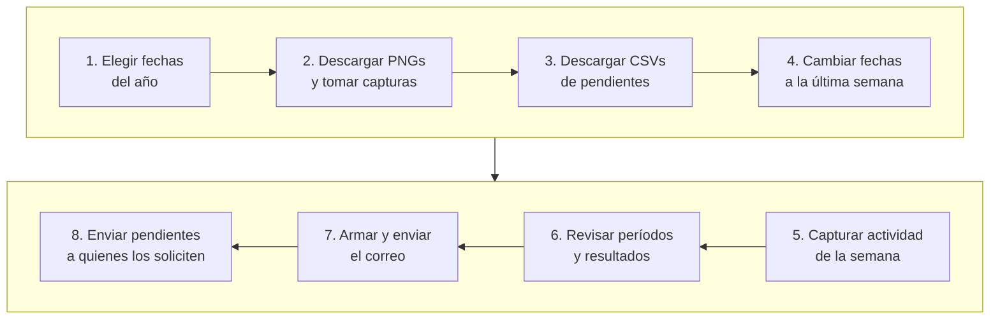

Cada material cubría una necesidad distinta:

| Material | Para qué se usaba |
|---|---|
| **PNGs y capturas** | Mostrar el panorama general y comparar avances. |
| **CSV** | Identificar qué personas seguían pendientes y qué contenidos les faltaban. |
| **Excel** | Reunir y distribuir parte de la información del seguimiento. |

El proceso completo demandaba aproximadamente una hora semanal para cada coordinador. Es una estimación operativa, no una medición formal. El problema no era solamente el tiempo: también existía la posibilidad de aplicar fechas distintas, omitir un archivo o distribuir información que no coincidiera con el resto del los archivos adjuntados.

### La solución: generar, revisar y compartir

Decidí incorporar la generación del informe al propio tablero. Así, los coordinadores ya no necesitan reunir extractos separados: el sistema prepara el reporte con fuentes y reglas definidas e incluye automáticamente el avance anual del programa.

Desde la pantalla Reportes, el coordinador ingresa una fecha inicial y una fecha final para definir el período de actividad que quiere informar. Habitualmente se utiliza una semana, pero las fechas son libres para contemplar envíos atrasados, feriados o informes mensuales, sin modificar la lógica del reporte ni el período del avance anual.

Con esas fechas, el sistema genera dos archivos: Reporte **Grupo A** y Reporte **Grupo B**. Cada coordinador solo debe descargar el correspondiente a su grupo, revisar la información y enviarlo por correo.


Los dos documentos comparten el mismo resumen general del programa. Después, cada archivo muestra el detalle de su grupo: cerca de 15 capacitadores, sus indicadores y sus pendientes nominales. Un grupo no recibe el detalle individual del otro, aunque ambos ven el mismo panorama agregado.

Podés [abrir el reporte HTML interactivo](https://jminolli-e.github.io/case-studies/capacitaciones/actualizacion/demo/reporte-actual.html) para explorar cómo se presenta el seguimiento y probar sus filtros con datos ficticios.

### Ya vi el porcentaje. ¿A quién tengo que capacitar?

Una parte importante de la solución fue incluir en el HTML la posibilidad de **descargar los pendientes en CSV**. Cada capacitador puede seleccionar su nombre, y descargar el listado de que que personal tiene pendiente de capacitar y en que capacitaciones.

<details>
<summary><strong>Ver los pendientes y la descarga CSV en el reporte</strong></summary>

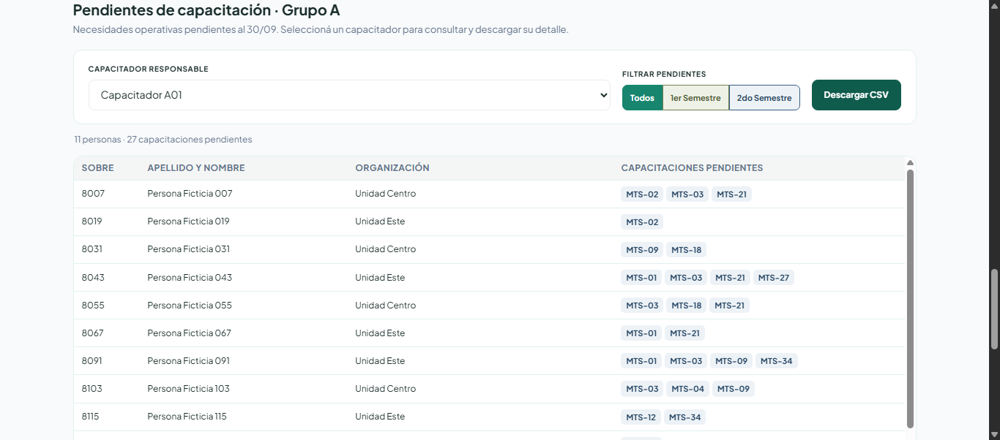

</details>

Esto resuelve algo que el informe visual por sí solo no podía resolver: además de ver cuánto falta, cada responsable necesita saber a quién capacitar y en qué temas. Al incluir el detalle en el reporte, ya no hace falta preparar y enviar un archivo individual para cada uno de los aproximadamente 30 capacitadores.

Incluir estos datos hace que el HTML pese más, pero permite compartir el informe y el detalle operativo en un solo archivo, sin depender del acceso al tablero. Al descargar el CSV, el navegador lo genera con los datos que ya están dentro del HTML, sin consultar un servidor ni necesitar un archivo adjunto.

> [!IMPORTANT]
> Todos los integrantes de un grupo, el coordinador y las jefaturas destinatarias reciben el mismo HTML de ese grupo. El selector facilita la consulta, pero **no restringe el acceso** a los demás registros nominales incluidos en el archivo.

La misma visibilidad permite a los capacitadores revisar sus pendientes y señalar registros faltantes o diferencias. Como los coordinadores cargan los datos mediante otro desarrollo del proceso, este control cruzado también ayuda a detectar omisiones de carga y mejorar la calidad de la información.

### Por qué elegí un HTML autocontenido

El HTML permite reunir información para distintas audiencias dentro de un único archivo. Un Gerente puede comenzar por el panorama general; un Jefe puede revisar la actividad y comparar avances; un capacitador puede filtrar su nombre y consultar las personas que todavía tiene pendientes.

Frente al conjunto anterior de PNGs, capturas, CSVs y Excel, el formato aporta:

- Un único archivo por grupo.
- Apertura local en cualquier navegador, sin instalar Python ni conectarse al dashboard.
- Diseño adaptable para computadoras y teléfonos.
- Mejor control visual que una planilla utilizada como informe.
- Más interacción que un documento estático como PDF.
- Filtros, tooltips y descarga CSV sin conexión a un servidor.

El documento incluye su estructura, estilos, datos e interacción. Python realiza las cargas y calcula los indicadores antes de generar el archivo. El reporte comparte con el dashboard la base, los universos cacheados y el cálculo del resumen general; para la actividad, el detalle prioritario y los pendientes utiliza cargas específicas. De esta manera, las reglas centrales se mantienen unificadas sin presentar como reutilizados en memoria resultados que pertenecen a otra pantalla. JavaScript no redefine las reglas de negocio: se limita a cambiar paneles visibles, abrir ayudas, filtrar información ya calculada y construir el CSV local.

El HTML exportado utiliza JavaScript local, no incorpora Plotly y no necesita Node.js para abrirse. Esto no significa que Plotly ni otras bibliotecas gráficas se hayan eliminado del proyecto; la demo navegable del dashboard, por ejemplo, utiliza Plotly local.

### Actividad del período y avance acumulado

Al reunir todo en un mismo documento, había que cuidar una distinción: lo que se hizo durante una semana no es lo mismo que el avance del programa anual. Por eso el reporte combina dos períodos:

| Parte del reporte | Período | Pregunta que responde |
|---|---|---|
| **Actividad** | Las fechas elegidas para el informe. | ¿Qué capacitaciones se realizaron en ese intervalo y quiénes las dictaron? |
| **Avance y pendientes** | Desde el inicio del año hasta la última fecha disponible del año de seguimiento. | ¿Cuánto se completó del programa y qué queda pendiente? |

La actividad cuenta las capacitaciones registradas durante el intervalo, tanto operativas como administrativas, y permite identificar a quienes no tuvieron actividad. El avance acumulado, en cambio, se calcula a partir de los cumplimientos y las capacitaciones requeridas: no es un promedio de la actividad semanal ni un promedio de porcentajes individuales.

El listado de pendientes surge del cruce entre las capacitaciones que necesita cada persona, su asignación actual a un responsable y lo que completó durante el período acumulado. No es una lista preparada a mano.

> [!NOTE]
> Las necesidades y asignaciones corresponden a la situación vigente. Cambiar las fechas de actividad no reconstruye las necesidades históricas del personal; un traslado, una licencia o un cambio de asignación puede modificar los porcentajes.

## Navegación: cuando encontrar una respuesta empezó a llevar más recorrido

Cada nuevo gráfico, tabla o mapa respondía una consulta real. El problema no era que hubiera más información, sino que todos esos análisis seguían apareciendo uno debajo del otro.

Los títulos ayudaban a separar visualmente cada bloque, pero no resolvían la navegación. **Si alguien solo necesitaba consultar un mapa de calor, ¿por qué tenía que atravesar todos los análisis anteriores para llegar a él?**

El recorrido tampoco era el único costo. Cada cambio de filtros hacía que el backend volviera a preparar los análisis de la pantalla: consultas, transformaciones y cálculos para gráficos, tablas e indicadores, incluso cuando la persona sólo necesitaba consultar uno de ellos. Eso añadía segundos de espera por información que no iba a utilizar.

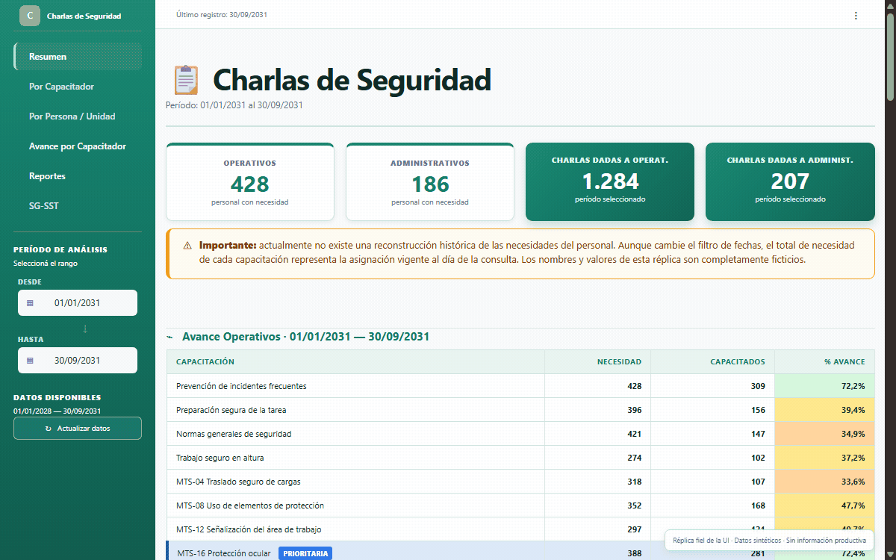

> [!NOTE]
> **Sobre el GIF:** busca ilustrar el recorrido que exigía la pantalla. Se recreó apartir de capturas anteriores del tablero por lo que no refleja fielmente cada detalle visual del tablero anterior.

También podés [explorar la réplica anterior del dashboard](https://jminolli-e.github.io/case-studies/capacitaciones/actualizacion/demo/dashboard.html), construida con datos ficticios.

### Elegir primero qué consultar

El menú lateral ya existía; el cambio estuvo en cómo se organizó la información dentro de cada pantalla. En lugar de seguir apilando componentes, la navegación quedó en dos niveles:

1. **Pantallas:** se eligen desde el menú lateral y representan una consulta principal. `Resumen` y `Avance por Capacitador` son dos ejemplos.
2. **Secciones:** se eligen mediante los controles horizontales dentro de cada pantalla. Permiten pasar, por ejemplo, del avance por capacitación a las prioritarias por capacitador, mostrando sólo los componentes relacionados con esa consulta.

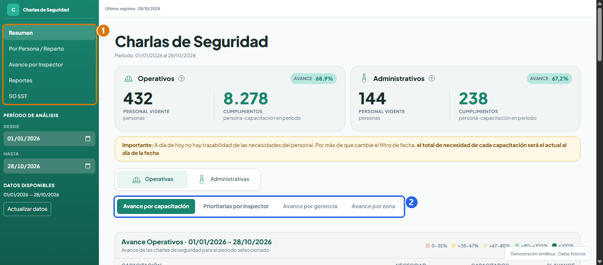

De esta manera, cada persona puede elegir la consulta que necesita sin recorrer todos los análisis anteriores. Podés [explorar el dashboard navegable](https://jminolli-e.github.io/case-studies/capacitaciones/actualizacion/demo/dashboard-actual.html) y probar sus pantallas y secciones con datos ficticios.

> [!NOTE]
> **Sobre las imágenes y la demo actual:** a diferencia de los mockups de la primera etapa, las capturas actuales se generaron con componentes y estilos del tablero original, utilizando datos ficticios. La demo navegable reproduce parte de esa interfaz en HTML con datos sintéticos; no es el tablero productivo completo. La versión anterior se presenta como una reconstrucción aproximada.

### Una interfaz con más contexto y menos ruido

Reorganizar no era solamente repartir lo que ya existía en nuevas secciones. También tuve que decidir qué componentes seguían ayudando y cuáles ocupaban espacio sin responder una necesidad actual.

Me tocó dejar ir algunos componentes. Había gráficos detallados y complejos que personalmente me parecían interesantes, pero que no se utilizaban. En la práctica, otras soluciones más sencillas ya ofrecían esa información. Aunque me había llevado trabajo construirlos, conservarlos sólo por eso no ayudaba a quienes necesitaban encontrar una respuesta.

También identifiqué componentes relacionados que estaban separados sin necesidad y los agrupé en una misma tarjeta para facilitar su lectura y mejorar la presentación visual. Por ejemplo, cada grupo —A y B— ahora reúne el avance ponderado, las personas con necesidad y los cumplimientos, lo que permite interpretar esa información en conjunto.

**Antes: cuatro indicadores separados**

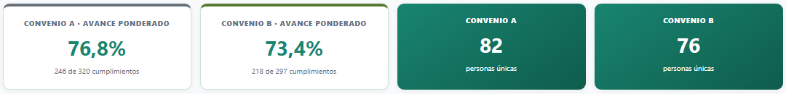

**Ahora: un contenedor por grupo**

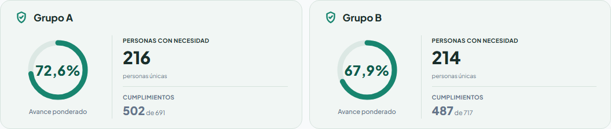

Algunas tarjetas y tablas incorporan **tooltips**, pequeñas ayudas que aparecen al pasar el cursor y explican qué representa un valor o cómo se calcula. Así se conserva el contexto sin llenar la pantalla de explicaciones permanentes.

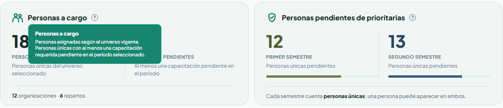

> [!NOTE]
> Podés ver otra comparación de la interfaz anterior y la actual en el apartado [Comparación visual](#comparación-visual), al final del caso.

## Evolución técnica de la solución

La primera versión concentraba gran parte de la orquestación en la aplicación principal. A medida que se incorporaron consultas, pantallas y exportaciones, esa estructura generó llamadas repetidas, componentes duplicados y más trabajo del necesario durante cada actualización de Streamlit.

La arquitectura actual es modular, pero no está dividida en capas completamente independientes. `app.py` continúa siendo el punto de entrada y coordina varias pantallas; las pantallas de avance por capacitador y reportes coordinan además sus propios recorridos de carga, cálculo y presentación.

En líneas generales, la información sigue este recorrido:

```text
Base de datos y vistas → cargas y cálculos → tablero en Streamlit
                                          ↘ reportes HTML por grupo
```

<details>
<summary><strong>Ver organización de los archivos</strong></summary>

```text
charla5min/
├── app.py                         # Entrada, navegación y orquestación
├── config/
│   ├── settings.py                # Configuración y constantes de negocio
│   └── styles.py                  # Estilos globales de Streamlit
├── database/
│   ├── connection.py              # Conexión SQLite de sólo lectura
│   ├── contracts.py               # Contratos de DataFrames
│   ├── loaders.py                 # SQL, caché, normalización y cruces
│   └── report_loaders.py          # Cargas específicas de reporting
├── services/
│   ├── avance_service.py          # Avance general y prioridades
│   ├── avance_inspector_service.py # Avance, detalle y pendientes
│   └── report_service.py          # Modelo de datos del reporte
├── ui/
│   ├── cards.py / navegacion.py / sidebar.py / tables.py
│   └── screens/
│       ├── resumen.py
│       ├── por_inspector.py
│       ├── persona_reparto.py
│       ├── avance_inspector.py
│       ├── reportes.py
│       └── sg_sst.py
├── reports/
│   └── export_html.py             # Renderer HTML, CSS y JavaScript
├── tests/
└── tools/                         # Capturas y baselines de caracterización
```

</details>

El recorrido de datos parte de SQLite y sus vistas, pasa por los loaders generales o específicos de reporting, y utiliza servicios puros para los cálculos principales. El dashboard termina en componentes Streamlit; el reporte pasa por `report_service.py` y `export_html.py` para producir dos HTML autocontenidos con sus datos, estilos e interacción local. Los loaders de reporting reutilizan algunos loaders generales y universos cacheados, pero también realizan cargas propias para la actividad, el detalle prioritario y los pendientes.

Para la navegación condicional, la versión productiva utiliza `st.radio` y `st.segmented_control`. Los cálculos específicos de las secciones inactivas esperan hasta que se seleccionen, a diferencia de las pestañas anteriores que preparaban contenido todavía no consultado.

La evolución permitió reducir trabajo repetido en algunos recorridos, reutilizar resultados cacheados y ejecutar cálculos específicos sólo cuando se selecciona la sección correspondiente. No publico un benchmark de rendimiento porque no se realizó una medición controlada antes y después.

## Cómo preservé las reglas de cálculo

La reorganización visual y el nuevo formato no debían producir indicadores diferentes. Para evitarlo:

- El resumen general del dashboard y el reporte reutilizan las mismas fuentes y funciones de cálculo del avance.
- El reporte utiliza loaders específicos para actividad, detalle prioritario y pendientes, pero mantiene sus reglas de transformación en servicios reutilizables.
- Hay pruebas automatizadas sobre navegación, servicios, contratos de DataFrames, filtros y generación del HTML.
- El renderer se prueba con datos sintéticos para verificar estructura, contenido, escape de valores e interacción.
- Realizo auditorías ocasionales comparando el HTML generado con las pantallas equivalentes del dashboard.

El feedback de las primeras revisiones también produjo cambios visibles. Se agregaron tooltips para explicar qué mide cada indicador y notas metodológicas al final del documento para aclarar por qué una modificación de necesidades, licencias, traslados o asignaciones puede cambiar los porcentajes.

## Mi participación

Los coordinadores me habían comentado más de una vez cuánto tiempo les llevaba preparar el seguimiento y me preguntaron si podía automatizar alguna parte. Yo también le había dado vueltas al problema. Ya había generado reportes HTML a partir de datos en el proyecto de auditorías, pero tardé en hacer una conexión que ahora parece evidente: si la información y los cálculos ya estaban en el tablero, ¿por qué no generar el reporte ahí mismo y descargarlo desde un botón?

Sinceramente siento que el proyecto no resuelve un problema espectacular, sino uno cotidiano: evita tener que reunir archivos y capturas cada semana y reduce las oportunidades de enviar información con fechas o filtros que no coinciden. No elimina la revisión humana ni corrige por sí solo un dato mal cargado, pero sí quita pasos manuales que podían introducir errores.

También disfruté poder dedicar atención a la experiencia de uso. Cuando las reglas de cálculo y las cargas están mejor organizadas, queda espacio para preguntarse si alguien encuentra lo que busca, entiende un indicador o puede recorrer el tablero sin perderse. Me pone contento haber construido algo que mis compañeros usan y agradecen. Para mí, automatizar estas tareas tiene sentido precisamente por eso: les devuelve tiempo y atención para trabajos que necesitan más de ellos.

## Alcance y privacidad

Este caso excluye nombres de empresa, personas, ubicaciones, correos, rutas, métricas productivas y reglas o consultas SQL corporativas. Las demos, capturas y animaciones utilizan información ficticia y no fueron construidas a partir de una copia anonimizada de la base real. Las capturas actuales usan componentes y estilos del tablero original; la demo navegable reproduce parte de esa interfaz y el reporte adapta el renderer visual productivo, ambos con datos sintéticos y terminología pública.

## Comparación visual

Las siguientes capturas utilizan datos ficticios y períodos diferentes. La versión anterior es una reconstrucción y la actual usa componentes y estilos del tablero original. Comparan la organización visual de las interfaces, no los resultados del programa.

<details>
<summary><strong>Resumen: indicadores y avance por capacitación</strong></summary>

Los cuatro indicadores separados pasan a agruparse por universo, junto con el porcentaje de avance. La tabla reúne su título, explicación y referencias en un mismo componente.

**Versión anterior**

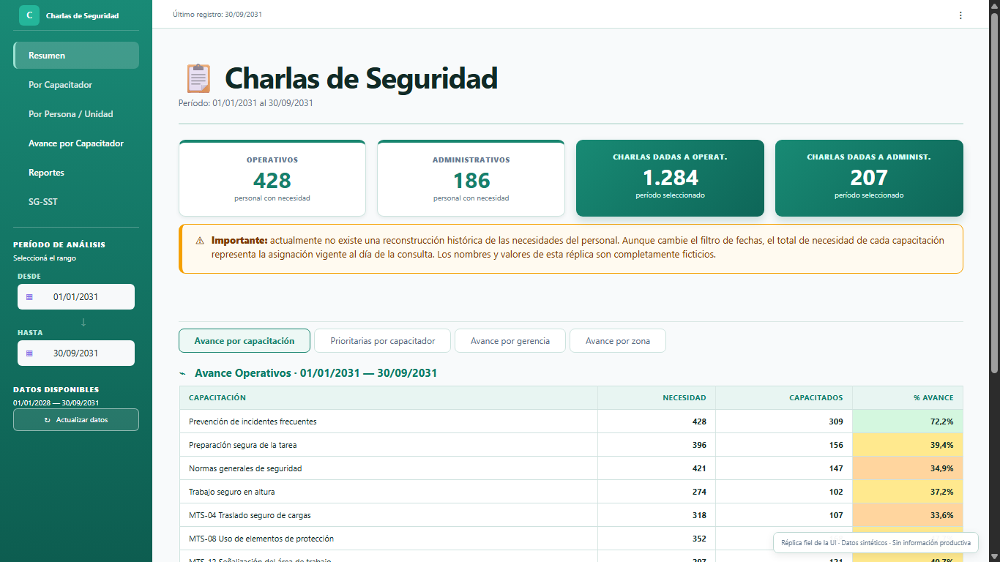

**Versión actual**

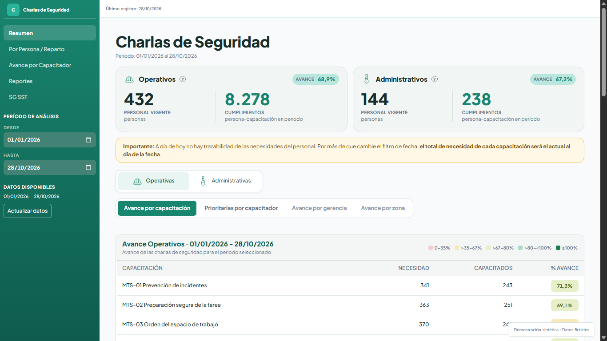

</details>

<details>
<summary><strong>Prioridades: avance por grupo</strong></summary>

Los indicadores que antes estaban repartidos en cuatro tarjetas se presentan en dos componentes, uno por grupo, que reúnen el avance ponderado, las personas con necesidad y los cumplimientos.

**Versión anterior**

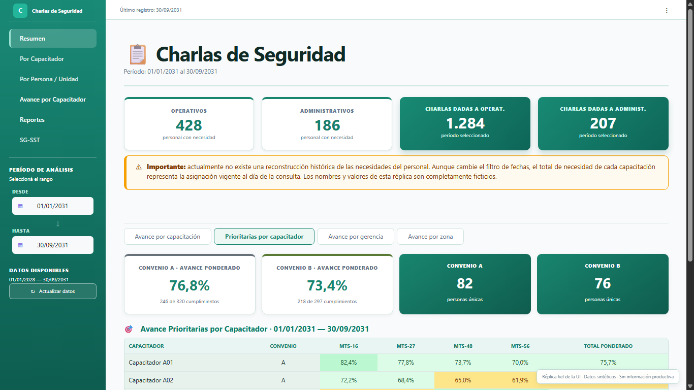

**Versión actual**

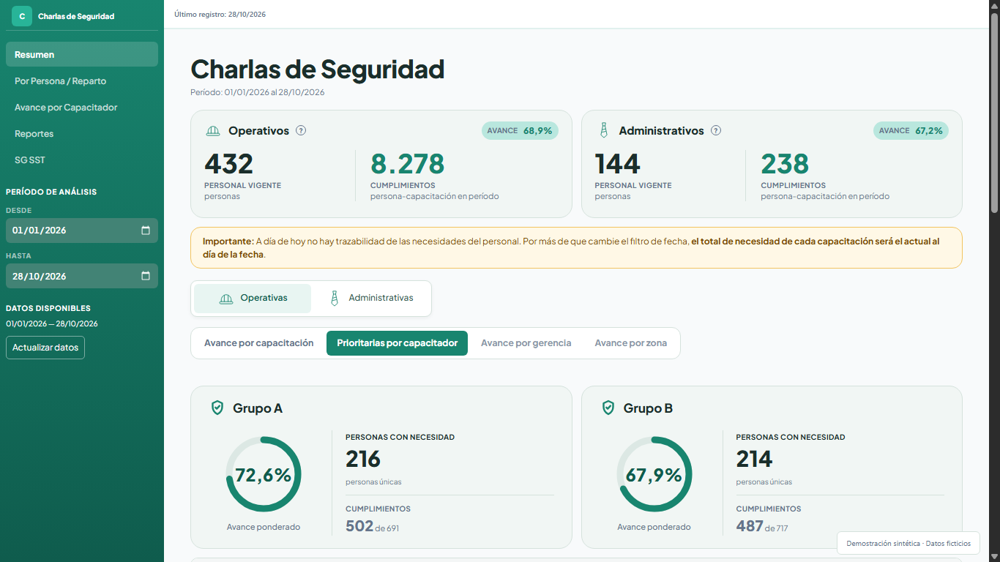

</details>
