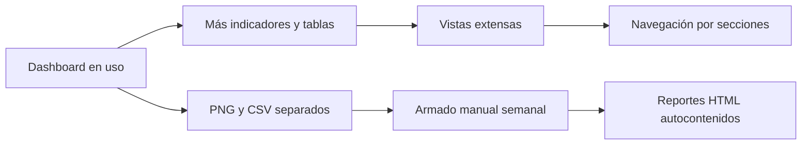
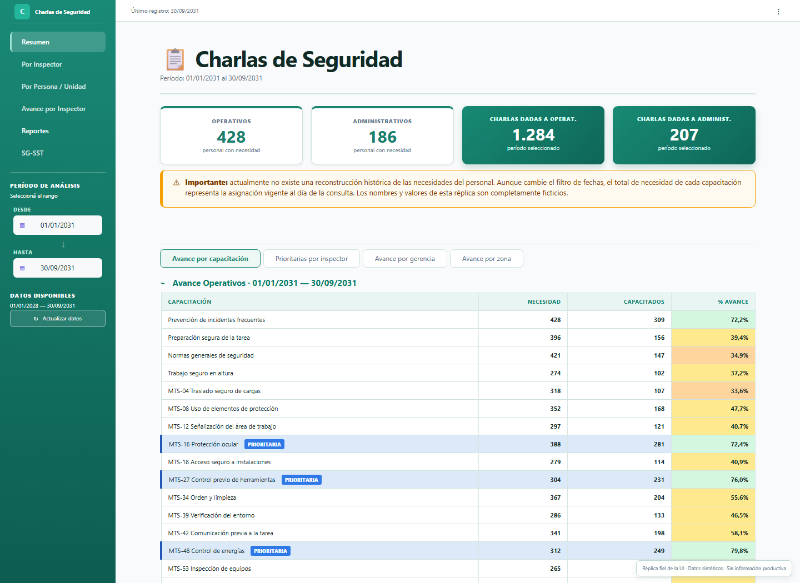
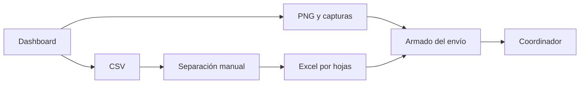
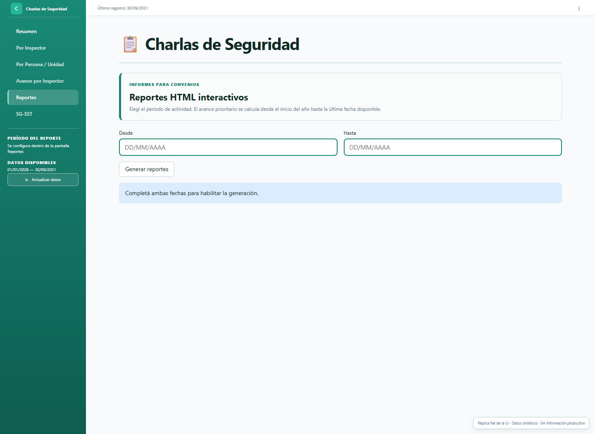
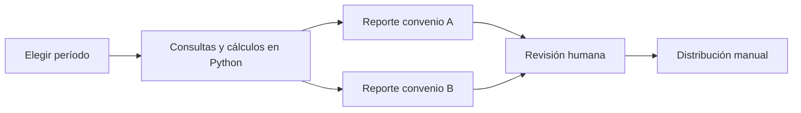
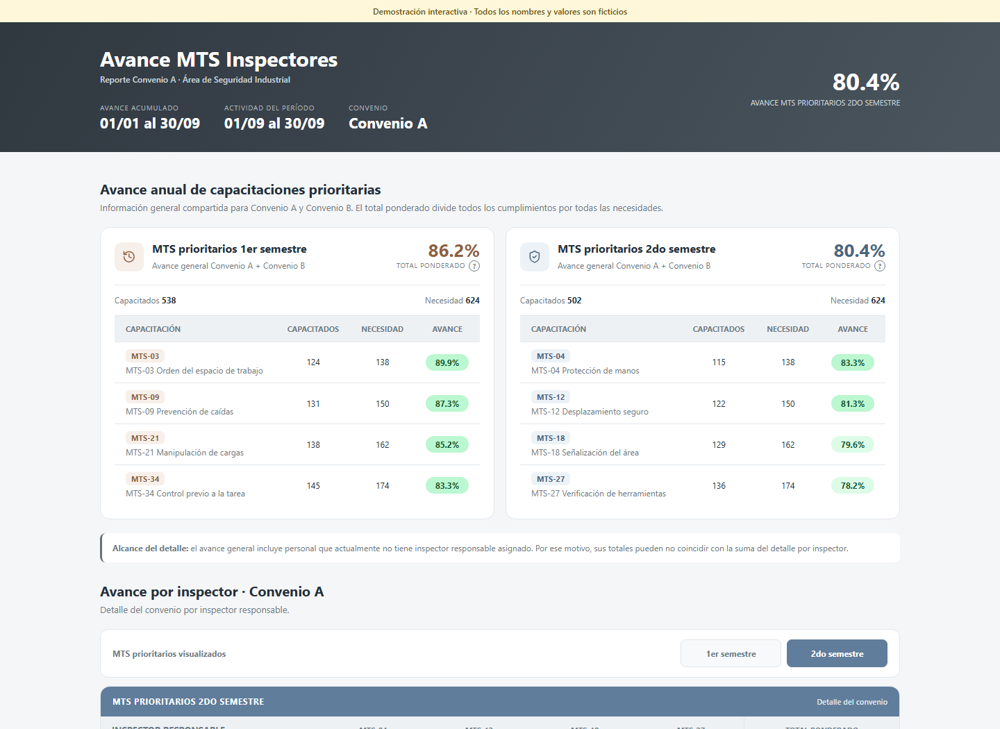
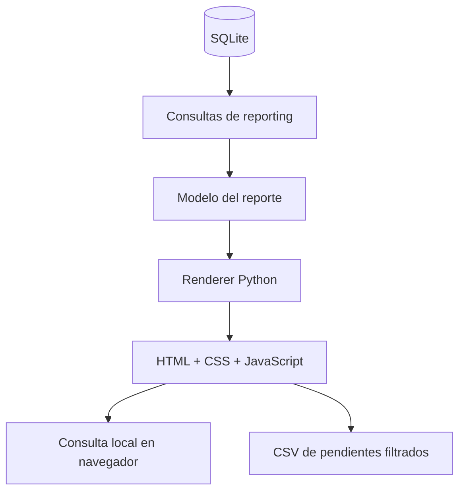

# Evolución de un dashboard operativo: navegación y reportes HTML

## Resumen ejecutivo

Después de poner en uso el [dashboard de seguimiento de coloquios](https://github.com/jminolli-e/case-studies/tree/main/coloquios), la herramienta siguió creciendo. Nuevos indicadores, comparaciones y tablas hicieron que algunas pantallas concentraran demasiada información. Además, dos referentes todavía debían preparar semanalmente material para los coordinadores: descargar archivos, separar pendientes, organizar hojas de cálculo y reunir capturas antes de distribuirlas.

Esta segunda etapa aborda ambos problemas sin reemplazar una solución que ya funciona:

- La interfaz pasó de vistas extensas a **seis pantallas principales**, con subsecciones que muestran únicamente el análisis elegido.
- Se incorporó una pantalla que genera **dos reportes HTML autocontenidos**, uno por convenio, con avance, actividad y pendientes consultables.
- El armado automatizado está diseñado para sustituir una secuencia manual que demandaba alrededor de **una hora semanal en total**.
- La revisión y distribución a los coordinadores continúa siendo humana y deliberada.

Los cambios están implementados y listos para comenzar a utilizarse. Este documento describe capacidades comprobables, pero no presenta métricas de adopción ni resultados productivos que todavía no fueron observados.

## Punto de partida

La primera versión resolvió el problema estructural: sustituyó un seguimiento disperso en Excel por una base SQLite normalizada y un dashboard Streamlit con reglas reproducibles. Cada capacitador pudo consultar su universo, los contenidos requeridos y el avance del período.

El desafío de esta etapa apareció después, como consecuencia del crecimiento de la propia herramienta. La información seguía siendo correcta, pero consultar una vista larga obligaba a desplazarse entre bloques que respondían preguntas diferentes. A la vez, el dashboard ofrecía exportaciones PNG y CSV, aunque preparar el seguimiento semanal requería combinarlas manualmente fuera del sistema.

## 1. Dividir la interfaz según la pregunta

La navegación principal organiza ahora el dashboard en seis pantallas:

En este documento uso **capacitador** como término público. La interfaz conserva la etiqueta **Inspector** para el mismo rol, por lo que esa denominación aparece en el reporte y en algunas vistas.

| Pantalla | Pregunta que responde |
|---|---|
| Resumen | ¿Cuál es el estado general del programa? |
| Por capacitador | ¿Qué actividad registró cada responsable? |
| Por persona / unidad | ¿Qué historial tiene una persona o una unidad? |
| Avance por capacitador | ¿Quién completó cada contenido y quién sigue pendiente? |
| Reportes | ¿Qué archivos de seguimiento deben prepararse para cada convenio? |
| SG-SST | ¿Qué cobertura tienen las capacitaciones específicas del sistema de gestión? |

La pantalla Resumen también separa el universo operativo del administrativo y divide sus análisis en subsecciones horizontales. Por ejemplo, el usuario puede pasar de avance por capacitación a prioridades por capacitador, gerencias o zonas sin recorrer todos esos bloques en una sola página.

La mejora de rendimiento se describe de manera cualitativa: la aplicación ejecuta y renderiza la pantalla y subsección seleccionadas en lugar de construir todo el contenido analítico a la vez. No se realizaron benchmarks comparativos, por lo que no corresponde atribuirle un porcentaje de aceleración.

## 2. Automatizar el armado, no la decisión de enviar

### Flujo anterior

Los dos referentes preparaban el material de seguimiento para convenios distintos. El trabajo combinado ocupaba aproximadamente una hora por semana y podía incluir:

1. Descargar el detalle en CSV.
2. Separar pendientes por capacitador.
3. Organizar la información en distintas hojas de Excel.
4. Descargar tablas como PNG o tomar capturas del dashboard.
5. Reunir los archivos y preparar la distribución a coordinadores.

### Flujo implementado

La nueva pantalla Reportes pide un rango de actividad, valida las fechas y genera un HTML para cada convenio. Cada archivo reúne:

- Avance acumulado de contenidos prioritarios.
- Comparación entre grupos de prioridades.
- Detalle ponderado por capacitador.
- Actividad del período seleccionado.
- Distribución de contenidos dictados.
- Consulta de pendientes por capacitador.
- Descarga CSV del filtro visible.
- Notas de metodología y alcance.

La automatización termina cuando los archivos quedan disponibles para descargar. El envío no es automático: el referente conserva el control sobre la revisión y la distribución.

## 3. Un documento que también funciona como interfaz

El formato HTML fue una decisión práctica. Un coordinador puede abrir el archivo en un navegador sin instalar Python, acceder a la base ni entrar al dashboard. El documento contiene su CSS, JavaScript y datos, por lo que mantiene filtros y descargas aun cuando se distribuye como un único archivo.

La [demostración interactiva](demo/index.html) fue generada con el mismo renderer Python utilizado por la funcionalidad real y un modelo construido completamente con datos sintéticos. Permite cambiar el grupo de prioridades, seleccionar un capacitador, filtrar sus pendientes y descargar el resultado visible como CSV.

## Arquitectura de esta etapa

La generación separa tres responsabilidades: obtener los datos, construir un modelo explícito y renderizar la salida. Los indicadores continúan siendo deterministas; JavaScript se utiliza para interacción local, no para recalcular las reglas de negocio.

## Aprendizaje transferido entre proyectos

Esta solución reutiliza un patrón que resultó útil en otras automatizaciones recientes: tratar el HTML autocontenido como un producto de reporting y no sólo como una página web.

El patrón combina:

- Cálculos resueltos antes de presentar la información.
- Un artefacto portable que no exige infraestructura adicional.
- Resumen y detalle dentro del mismo documento.
- Interacción suficiente para responder preguntas operativas.
- Revisión humana antes de distribuir resultados.

Transferir el criterio no significó copiar un reporte. La jerarquía visual, los indicadores y los filtros se diseñaron para el dominio de capacitaciones y su seguimiento por convenio.

## Tecnologías utilizadas

| Tecnología | Uso en esta etapa |
|---|---|
| Python | Consultas, reglas, construcción del modelo y render del reporte. |
| SQLite | Fuente relacional compartida por carga, dashboard y reporting. |
| Streamlit | Dashboard, navegación y descarga de los archivos generados. |
| Pandas | Preparación y agregación de datos. |
| HTML y CSS | Documento autocontenido y diseño responsivo. |
| JavaScript | Filtros, cambio de vistas y descarga local de CSV. |
| Plotly y Matplotlib | Visualizaciones del dashboard y exportaciones PNG existentes. |

## Estado y límites actuales

- La navegación y los reportes están implementados y listos para iniciar su adopción operativa.
- La hora semanal describe el costo aproximado del flujo anterior; todavía no es una métrica de ahorro validada después del despliegue.
- La distribución de los HTML sigue siendo manual.
- Las mejoras de carga son cualitativas y no cuentan con un benchmark publicado.
- La necesidad histórica continúa calculándose con la asignación organizativa vigente, una limitación ya identificada en el caso original.
- Existe una migración inicial hacia React, TypeScript y FastAPI, pero aún no reemplaza al dashboard Streamlit ni reproduce toda su funcionalidad.

## Evidencia visual y privacidad

Las imágenes del dashboard son réplicas públicas fieles de su estructura visual actual: reproducen la navegación, las subsecciones y los componentes relevantes con nombres y cifras inventados. No son capturas del entorno productivo. La réplica omite el chrome del framework y artefactos incidentales de renderizado que no forman parte del diseño funcional.

La captura del reporte y la demo sí provienen del renderer funcional, ejecutado contra un modelo sintético. Ningún artefacto de esta carpeta se generó desde una copia anonimizada de la base real.

## Próximos pasos

- Validar el nuevo flujo con los referentes y coordinadores.
- Medir tiempo de preparación, frecuencia de uso y consultas posteriores al envío.
- Incorporar la devolución de usuarios antes de ampliar la automatización.
- Continuar la migración React/FastAPI por incrementos verificables, sin declarar equivalencia hasta cubrir las funciones operativas.

## Disclaimer

Este caso de estudio documenta decisiones técnicas y de proceso con fines profesionales. Los nombres de empresa, convenios, personas, unidades, rutas, correos y métricas productivas fueron excluidos.

Todos los nombres y valores visibles en la demo y las imágenes son ficticios. La estructura fue simplificada cuando era necesario para impedir que la combinación de detalles permita reconstruir el entorno real.
