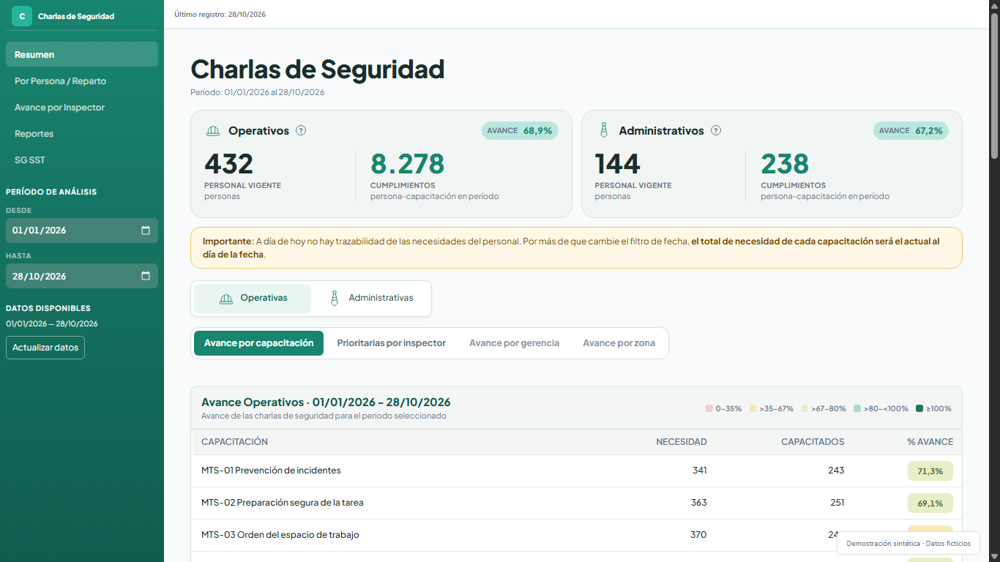
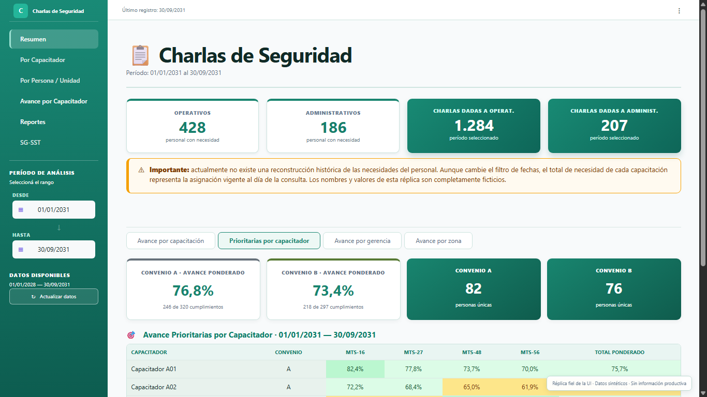
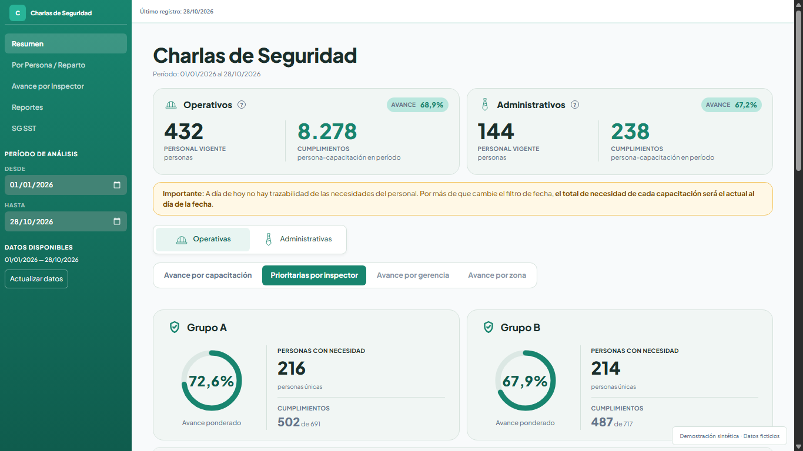

# Evolución del dashboard: navegación y reportes HTML

Esta es la actualización de un [proyecto que ya había documentado](../): un tablero para hacer seguimiento de las charlas de seguridad y saber cómo avanza el programa de capacitaciones.

La idea es poder pasar de una pregunta a una respuesta sin tener que reconstruir la información a mano. Por ejemplo:

- ¿Cuántas personas forman parte del personal operativo y cuántas del administrativo?
- ¿Cómo avanza una capacitación específica? ¿Y las capacitaciones prioritarias del programa 2026?
- ¿En qué fecha realizó una persona una capacitación?
- ¿Cuántas personas tiene pendientes de capacitar un responsable y quiénes son?
- ¿Dónde trabajan esas personas y qué temas del programa les faltan?

Las preguntas son sencillas. Lo desafiante es que las respuestas sigan teniendo sentido con el paso del tiempo, cuando las personas cambian de puesto u organización, toman una licencia o cambia su situación de alguna otra manera.

El tablero tiene incorporada toda esta lógica de negocio para acompañar esos cambios sin tener que corregir indicadores a mano cada vez que ocurre uno. Por ejemplo, cuando se actualizan los datos de una licencia o de un cambio de puesto, el tablero vuelve a calcular las métricas y las necesidades de capacitación que correspondan. Así, el objetivo es que el seguimiento siga siendo útil con el tiempo y requiera la menor intervención posible, sin depender de ajustes constantes en el backend.

No todas las personas necesitan las mismas charlas: eso depende de su puesto, sus tareas y el departamento al que pertenecen. El tablero cruza esas necesidades con las capacitaciones registradas para mostrar tanto el panorama general como el detalle que permite actuar sobre los pendientes.

Con el tiempo, el tablero fue sumando análisis útiles, pero también pantallas cada vez más largas. Además, para enviar el avance semanal a jefaturas y capacitadores había que navegar por distintas secciones, descargar planillas y gráficos, tomar capturas y reunir todo en un informe.

### Entonces ¿Que resuelve esta actualización?
Esta actualización aborda ambos problemas: **reorganiza la navegación mejorando el UX/UI ** para que sea más fácil encontrar cada consulta, y permite generar **reportes HTML interactivos** que reúnen las partes más importantes del seguimiento cuya idea es que cada destinatario del reporte semanal pueda encontrar en un mismo archivo las respuestas que necesita.


- **[Explorar el dashboard navegable](https://jminolli-e.github.io/case-studies/coloquios/actualizacion/demo/dashboard-actual.html):** recorrer las pantallas y secciones disponibles en la demo.
- **[Abrir el reporte HTML interactivo](https://jminolli-e.github.io/case-studies/coloquios/actualizacion/demo/reporte-actual.html):** consultar indicadores, filtros y descarga CSV. La demo conserva algunas etiquetas «Convenio»; en este caso se utiliza «Grupo».
- **Versiones anteriores:** se conservan la [réplica anterior del dashboard](./demo/dashboard.html) y el [reporte anterior](./demo/index.html) como archivos fuente.

### Dos maneras de recorrer la solución

| Si querés... | Podés empezar por... |
|---|---|
| Revisar una demo del tablero | [El tablero navegable](https://jminolli-e.github.io/case-studies/coloquios/actualizacion/demo/dashboard-actual.html) |
| Ver el diseño del reporte semanal | [El reporte HTML interactivo](https://jminolli-e.github.io/case-studies/coloquios/actualizacion/demo/reporte-actual.html) |

## Un poco de contexto

Un **coloquio** es una instancia breve de capacitación sobre un contenido de seguridad. No todas las personas necesitan completar los mismos contenidos: la necesidad depende del puesto, de las tareas que realizan y del departamento al que pertenecen. Algunos contenidos se definen como prioritarios para concentrar el seguimiento durante una etapa del año.

El panel permite comparar esas necesidades con las capacitaciones registradas. De esa comparación surgen el porcentaje de avance del programa, el detalle de las personas que todavía tienen contenidos pendientes y el seguimiento de la cantidad y el avance de las actividades realizadas por cada capacitador.

En resumen, el panel permite:
- Cantidad de personas que requieren cada capacitación.
- Personas capacitadas, pendientes y porcentaje de avance.
- Comparaciones por capacitación, gerencia, zona, organización y reparto.
- Seguimiento de capacitaciones prioritarias.
- Actividad histórica de capacitadores.
- Situación particular de una persona mediante su número de identificación interno.
- Detalle nominal de personas que todavía tienen capacitaciones pendientes.
- Cobertura y cumplimiento de capacitaciones obligatorias de SG-SST.

En este caso utilizo dos términos que conviene distinguir:

- **Capacitador responsable:** hace seguimiento de las personas y contenidos que tiene asignados. A ese conjunto también lo llamo su *universo*.
- **Capacitador que dictó:** es quien figura en el registro de una charla realizada. Puede coincidir o no con el responsable: una persona puede estar asignada al capacitador A y recibir una charla del capacitador B. Para el avance importa que la persona haya completado el contenido; distinguir ambos roles permite ver tanto la responsabilidad de seguimiento como la actividad efectivamente dictada.

## Qué cambió

| | Antes | Ahora |
|---|---|---|
| **Navegación** | Los análisis se iban apilando en pantallas largas. | Las pantallas y secciones agrupan cada consulta y le dan un lugar más fácil de encontrar. |
| **Reporte semanal** | Había que reunir capturas, imágenes y planillas, y revisar sus fechas y filtros. | Se generan dos archivos HTML, uno por grupo, para revisar y enviar. |

## El problema de navegación anterior

El crecimiento del dashboard era útil desde el punto de vista funcional: cada nuevo gráfico, tabla o mapa respondía una consulta real. El problema era que la interfaz seguía creciendo hacia abajo. Dentro de `Resumen`, por ejemplo, podían convivir los indicadores generales, el avance por capacitación, las prioridades por capacitador, comparaciones por gerencia y zona, mapas de calor y listados operativos.

Los títulos ayudaban a separar visualmente cada bloque, pero no resolvían la navegación. Para llegar a un gráfico o mapa de calor ubicado al final había que atravesar los bloques anteriores, aunque no fueran relevantes para esa consulta. Al actualizar el tablero o incorporar un análisis, los elementos cambiaban de posición y dejaban de encontrarse donde las personas estaban acostumbradas.

## Recorrido 1: consultar el tablero

Reorganicé la interfaz en dos niveles:

- Una **pantalla** representa una pregunta principal y se elige desde el menú lateral. `Resumen` y `Avance por Capacitador` son dos ejemplos.
- Una **sección** representa un análisis puntual dentro de una pantalla. Se selecciona mediante un control horizontal y muestra sólo los componentes relacionados con esa consulta.

La separación no es solamente visual. Los indicadores generales de una pantalla siguen calculándose una vez, pero las consultas y transformaciones propias de cada sección esperan hasta que alguien la elija. Así se evita preparar análisis que todavía no se están consultando. Más abajo cuento cómo se resolvió en Streamlit.

### Resumen

`Resumen` conserva los indicadores generales del programa y permite cambiar entre análisis como el avance por capacitación y las prioridades por capacitador. En lugar de apilar todas las tablas y gráficos, el área principal se reemplaza cuando cambia la sección.

La sección de prioridades conserva la distinción operativa entre `Grupo A` y `Grupo B`, presenta sus indicadores generales y compara el avance de los capacitadores responsables. Para calcular el **avance ponderado** se dividen todos los cumplimientos por todas las capacitaciones requeridas; no se promedian los porcentajes individuales.

### Avance por Capacitador

Esta pantalla permite seleccionar un capacitador responsable y consultar el universo que tiene asignado. Sus secciones separan el avance por contenido, el desglose por organización y las personas que todavía tienen capacitaciones pendientes.

La información sirve para acompañar el trabajo de capacitación y señalar tareas pendientes, pero no pretende medir por sí sola la calidad o efectividad profesional de una persona. Los capacitadores también realizan otras tareas que no forman parte de estos indicadores.

La réplica pública implementa estos flujos seleccionados con información sintética. No reproduce todas las pantallas ni todas las variantes administrativas del sistema productivo.

### Evolución visual: menos es más

Además de reorganizar la navegación, revisé la jerarquía visual de los componentes. Una métrica puede ser medible sin ser necesaria en una pantalla de uso diario: si nadie la consulta, ocupa espacio y obliga a las personas a recorrer más información para encontrar lo importante.

La interfaz actual agrupa indicadores relacionados, incorpora el avance en las tarjetas de cada universo y reúne título, explicación, leyenda y tabla en componentes más fáciles de leer. La navegación lateral es más compacta. La antigua pantalla `Por Inspector` dejó de ser una pantalla independiente: su información útil se integró como `Actividad histórica` en `Avance por Inspector`, separando lo que una persona dictó de la responsabilidad sobre el universo que tiene asignado.

La reorganización busca reducir recorridos innecesarios y facilitar la consulta a personas con distintos niveles de familiaridad digital, sin quitar controles ni contexto útil. Al final se presenta una [comparación visual](#comparación-visual) de dos secciones.

## Recorrido 2: preparar y usar el reporte HTML

### Cómo se preparaba el seguimiento semanal

El seguimiento está dividido entre dos coordinadores y dos grupos. Cada coordinador trabaja con aproximadamente 15 capacitadores de `Grupo A` o `Grupo B`. La separación responde a la organización operativa del programa, pero ese criterio no es necesario para comprender la solución técnica.

```text
Antes:  Tablero → imágenes + capturas + CSV + Excel → armado y revisión manual
Ahora:  Elegir fechas → generar un HTML por grupo → revisar y enviar
```

Antes de esta actualización, preparar el material implicaba combinar distintas salidas:

1. Configurar el período de consulta dentro del dashboard.
2. Descargar PNG que resumían el avance general y los contenidos prioritarios.
3. Descargar CSV con personas y capacitaciones pendientes.
4. Tomar capturas de otros componentes que no formaban parte de los PNG exportables.
5. Organizar parte de la información en un Excel consolidado.
6. Preparar, cuando se solicitaba, un CSV o detalle específico para un capacitador.
7. Revisar que las fechas y filtros utilizados en cada archivo coincidieran antes de enviarlos.

Los archivos cumplían objetivos diferentes. Los PNG y las capturas mostraban la situación general o una comparación visual; los CSV contenían el detalle nominal necesario para saber a qué personas debía capacitar cada responsable y en qué contenidos; el Excel se utilizaba para reunir y distribuir parte de ese material.

Como el filtro de fechas afectaba a todo el tablero, había que cambiarlo varias veces y comprobar que cada descarga correspondiera al período esperado. Un error en ese paso podía hacer que una parte del informe no coincidiera con las demás.

El proceso completo demandaba aproximadamente una hora semanal entre ambos coordinadores. Es una estimación: podía variar según la cantidad de archivos individuales solicitados y no existía una medición formal. El principal problema no era solamente el tiempo, sino también la posibilidad de aplicar fechas distintas, omitir un archivo o distribuir información que no coincidiera con el resto del paquete.

### Qué genera ahora el sistema

Desde la pantalla `Reportes`, el coordinador ingresa una fecha inicial y una fecha final para definir el período de actividad que quiere revisar. Habitualmente se utiliza una ventana semanal, pero las fechas son libres: permiten contemplar un envío atrasado, un feriado o la preparación de un informe mensual sin cambiar la lógica del reporte. Con ese período se generan dos documentos, uno para cada grupo de seguimiento.

Cada HTML combina dos períodos distintos. Tenerlos presentes ayuda a interpretar lo que muestra el informe:

| Parte del reporte | Período | Pregunta que responde |
|---|---|---|
| **Actividad** | Las fechas elegidas para el informe. | ¿Qué capacitaciones se realizaron en ese intervalo y quiénes las dictaron? |
| **Avance y pendientes** | Desde el inicio del año hasta la última fecha disponible del año de seguimiento. | ¿Cuánto se completó del programa y qué queda pendiente? |

La actividad cuenta los registros de capacitaciones realizadas en el intervalo: ordena la cantidad dictada por cada capacitador y los contenidos más dictados, muestra mediante ayudas cuánto aportó cada persona e identifica a quienes no tuvieron actividad.

El avance acumulado no es un promedio de la actividad semanal. En los pendientes se puede elegir entre las prioridades de cada semestre o todos los pendientes operativos de las personas asignadas a un responsable.

Los dos documentos comparten el mismo resumen agregado del programa, que contempla a los aproximadamente 30 capacitadores. Después, cada archivo muestra únicamente el detalle del grupo correspondiente a su coordinador: cerca de 15 capacitadores, sus indicadores y sus pendientes nominales. Un grupo no recibe el detalle individual del otro, aunque ambos ven el mismo panorama agregado.

Todos los integrantes de un grupo, el coordinador y las jefaturas destinatarias reciben el mismo HTML de ese grupo. Esta distribución es intencional y forma parte del funcionamiento definido para el programa.

El selector de capacitador facilita la consulta, pero **no restringe el acceso**: el HTML contiene los registros nominales de todos los capacitadores del grupo correspondiente.

### Qué contiene el reporte HTML

El documento reúne información que antes estaba distribuida entre varias pantallas, secciones y descargas:

- Avance acumulado de las capacitaciones prioritarias del primer y segundo semestre.
- Totales de personas capacitadas, necesidades y porcentaje ponderado.
- Comparación del avance prioritario por capacitador responsable.
- Actividad realizada dentro de las fechas elegidas, normalmente utilizada como avance semanal, pero adaptable a otros intervalos.
- Cantidad de capacitaciones efectivamente realizadas por cada capacitador que dictó actividades, ordenada de mayor a menor.
- Distribución de esa actividad por contenido de capacitación, con tooltips que detallan cuánto aportó cada capacitador.
- Separación de los contenidos entre capacitaciones operativas y administrativas.
- Listado final con todas las capacitaciones dictadas en el período, no sólo las que fueron definidas como prioritarias.
- Inclusión de capacitadores sin actividad durante el período, para que la ausencia de registros también sea visible.
- Personas y contenidos que continúan pendientes para cada capacitador responsable.
- Filtro para mostrar todas las capacitaciones operativas pendientes o sólo las prioritarias de un semestre.
- Descarga CSV del detalle que está visible después de aplicar los filtros.
- Tooltips que explican el significado y la fórmula de los indicadores.
- Notas metodológicas sobre asignaciones, alcance y motivos por los que los porcentajes pueden cambiar.

El listado de pendientes se obtiene cruzando las capacitaciones que necesita cada persona actualmente, la asignación actual a un capacitador y las capacitaciones registradas durante el período acumulado. El resultado no es una lista cargada manualmente: se calcula a partir de las vistas y registros de la base.

Las necesidades y asignaciones corresponden a la situación vigente: cambiar las fechas de actividad no reconstruye las necesidades históricas del personal.

La tabla de pendientes permite seleccionar un capacitador responsable, alternar entre contenidos prioritarios y el universo operativo completo, y descargar el detalle visible.

El reporte también recibió la nueva tipografía y componentes agrupados. La versión actual conserva el filtro de pendientes por `Todos`, `1er semestre` y `2do semestre`, además de la descarga CSV del resultado visible.

Podés consultar el [reporte HTML actual interactivo](./demo/reporte-actual.html) para explorar directamente sus indicadores, filtros y descarga CSV.

### Por qué elegí un HTML autocontenido

El HTML permite reunir información para distintas audiencias dentro de un único archivo. Una jefatura puede comenzar por el panorama general; un coordinador puede revisar la actividad y comparar avances; un capacitador puede filtrar su nombre y consultar las personas que todavía tiene pendientes.

Frente al conjunto anterior de PNG, capturas, CSV y Excel, el formato aporta:

- Un único archivo por grupo.
- Apertura local en cualquier navegador, sin instalar Python ni conectarse al dashboard.
- Diseño adaptable para computadoras y teléfonos.
- Mejor control visual que una planilla utilizada como informe.
- Más interacción que un documento estático como PDF.
- Filtros, tooltips y descarga CSV sin conexión a un servidor.

El documento incluye su estructura, estilos, datos e interacción. Python realiza las cargas y calcula los indicadores antes de generar el archivo. El reporte comparte con el dashboard la base, los universos cacheados y el cálculo del resumen general; para la actividad, el detalle prioritario y los pendientes utiliza cargas específicas. De esta manera, las reglas centrales se mantienen unificadas sin presentar como reutilizados en memoria resultados que pertenecen a otra pantalla. JavaScript no redefine las reglas de negocio: se limita a cambiar paneles visibles, abrir ayudas, filtrar información ya calculada y construir el CSV local.

El HTML exportado utiliza JavaScript local, no incorpora Plotly y no necesita Node.js para abrirse. Esto no significa que Plotly ni otras bibliotecas gráficas se hayan eliminado del proyecto; la demo navegable del dashboard, por ejemplo, utiliza Plotly local.

## Una salida controlada y trazable en lugar de un reporte generado de forma ad hoc

En lugar de reconstruir el informe a partir de extractos, manualmente o mediante una herramienta de IA, el reporte consume fuentes y resultados calculados mediante reglas definidas en código y mantiene alineado el resumen general con el dashboard. Para un mismo estado de las fuentes, configuración y fechas, produce los mismos indicadores, aunque el archivo conserve metadatos propios de cada generación. La revisión y el envío siguen siendo decisiones humanas.

El reporte también mejora el control cruzado. Antes, algunos detalles podían omitirse de los informes enviados a los capacitadores porque una inconsistencia podía generar confusión y reclamos. Ahora los capacitadores reciben el detalle necesario para revisar sus propios pendientes y detectar registros faltantes o diferencias. Como los coordinadores cargan los datos mediante otro desarrollo del mismo proceso, esta visibilidad permite detectar errores u omisiones de carga y revisar también la calidad del trabajo de data entry. El resultado es una comprensión compartida del estado del programa y una oportunidad concreta para pulir los datos antes de que las inconsistencias se acumulen.

## Evolución técnica de la solución

La primera versión concentraba gran parte de la orquestación en la aplicación principal. A medida que se incorporaron consultas, pantallas y exportaciones, esa estructura generó llamadas repetidas, componentes duplicados y más trabajo del necesario durante cada actualización de Streamlit.

La arquitectura actual es modular, pero no está dividida en capas completamente independientes. `app.py` continúa siendo el punto de entrada y coordina varias pantallas; las pantallas de avance por capacitador y reportes coordinan además sus propios recorridos de carga, cálculo y presentación.

En líneas generales, la información sigue este recorrido:

```text
Base de datos y vistas → cargas y cálculos → tablero en Streamlit
                                          ↘ reportes HTML por grupo
```

<details>
<summary><strong>Ver organización de los archivos</strong></summary>

```text
charla5min/
├── app.py                         # Entrada, navegación y orquestación
├── config/
│   ├── settings.py                # Configuración y constantes de negocio
│   └── styles.py                  # Estilos globales de Streamlit
├── database/
│   ├── connection.py              # Conexión SQLite de sólo lectura
│   ├── contracts.py               # Contratos de DataFrames
│   ├── loaders.py                 # SQL, caché, normalización y cruces
│   └── report_loaders.py          # Cargas específicas de reporting
├── services/
│   ├── avance_service.py          # Avance general y prioridades
│   ├── avance_inspector_service.py # Avance, detalle y pendientes
│   └── report_service.py          # Modelo de datos del reporte
├── ui/
│   ├── cards.py / navegacion.py / sidebar.py / tables.py
│   └── screens/
│       ├── resumen.py
│       ├── por_inspector.py
│       ├── persona_reparto.py
│       ├── avance_inspector.py
│       ├── reportes.py
│       └── sg_sst.py
├── reports/
│   └── export_html.py             # Renderer HTML, CSS y JavaScript
├── tests/
└── tools/                         # Capturas y baselines de caracterización
```

</details>

El recorrido de datos parte de SQLite y sus vistas, pasa por los loaders generales o específicos de reporting, y utiliza servicios puros para los cálculos principales. El dashboard termina en componentes Streamlit; el reporte pasa por `report_service.py` y `export_html.py` para producir dos HTML autocontenidos con sus datos, estilos e interacción local. Los loaders de reporting reutilizan algunos loaders generales y universos cacheados, pero también realizan cargas propias para la actividad, el detalle prioritario y los pendientes.

Para la navegación condicional, la versión productiva utiliza `st.radio` y `st.segmented_control`. Los cálculos específicos de las secciones inactivas esperan hasta que se seleccionen, a diferencia de las pestañas anteriores que preparaban contenido todavía no consultado.

La evolución permitió reducir trabajo repetido en algunos recorridos, reutilizar resultados cacheados y ejecutar cálculos específicos sólo cuando se selecciona la sección correspondiente. No publico un benchmark de rendimiento porque no se realizó una medición controlada antes y después.

## Cómo preservé las reglas de cálculo

La reorganización visual y el nuevo formato no debían producir indicadores diferentes. Para evitarlo:

- El resumen general del dashboard y el reporte reutilizan las mismas fuentes y funciones de cálculo del avance.
- El reporte utiliza loaders específicos para actividad, detalle prioritario y pendientes, pero mantiene sus reglas de transformación en servicios reutilizables.
- Hay pruebas automatizadas sobre navegación, servicios, contratos de DataFrames, filtros y generación del HTML.
- El renderer se prueba con datos sintéticos para verificar estructura, contenido, escape de valores e interacción.
- Realizo auditorías ocasionales comparando el HTML generado con las pantallas equivalentes del dashboard.

El feedback de las primeras revisiones también produjo cambios visibles. Se agregaron tooltips para explicar qué mide cada indicador y notas metodológicas al final del documento para aclarar por qué una modificación de necesidades, licencias, traslados o asignaciones puede cambiar los porcentajes.

## Mi participación

La necesidad no surgió de un único pedido formal. Distintas personas plantearon problemas parciales: agrupar CSV, reunir componentes para no enviar capturas separadas y reducir el tiempo perdido preparando el reporte. También señalaron errores derivados de configurar manualmente los filtros de fecha varias veces.

A partir de esos pedidos diseñé e implementé individualmente la reorganización de la navegación, las optimizaciones de consultas, el modelo de reporting y el renderer HTML. Los coordinadores aportaron el contexto operativo y el feedback necesario para ajustar la salida a la forma en que realizan el seguimiento.

## Adopción inicial

Durante las primeras dos semanas de uso, los dos coordinadores utilizaron los reportes semanalmente. En ese período inicial, la generación y el primer control contra el dashboard no demandaron más de aproximadamente cinco minutos por ciclo.

La comparación con la hora semanal del proceso anterior debe leerse como una estimación operativa temprana, no como un estudio formal de ahorro. Todavía no existe una ventana de observación suficiente para afirmar un resultado sostenido de largo plazo.


## Próximo avance

La interfaz operativa sigue construida en Streamlit. Existe en otro repositorio un primer borrador de migración hacia React y TypeScript con FastAPI como backend.

El objetivo no es cambiar de tecnología por sí mismo. Streamlit permitió entregar rápidamente una herramienta útil, pero ofrece menos control sobre el layout y utiliza un modelo de ejecución basado en reruns. Como exploración posible, una separación más explícita entre frontend y API podría permitir construir interacciones más flexibles, controlar mejor la experiencia visual y evolucionar la interfaz sin volver a implementar las reglas que ya fueron validadas. La interfaz también puede seguir mejorando visualmente sin que una migración sea inevitable.

## Alcance y privacidad

Este caso excluye nombres de empresa, personas, ubicaciones, correos, rutas, métricas productivas y reglas o consultas SQL corporativas. Las demos, capturas y animaciones utilizan información ficticia y no fueron construidas a partir de una copia anonimizada de la base real. El HTML de la demo actual adapta el renderer visual productivo con datos sintéticos y terminología pública.

## Comparación visual

Las siguientes capturas corresponden a reconstrucciones con datos ficticios y períodos diferentes. Comparan la organización visual de las interfaces, no los resultados del programa.

<details>
<summary><strong>Resumen: indicadores y avance por capacitación</strong></summary>

Los cuatro indicadores separados pasan a agruparse por universo, junto con el porcentaje de avance. La tabla reúne su título, explicación y referencias en un mismo componente.

**Versión anterior**


**Versión actual**



</details>

<details>
<summary><strong>Prioridades: avance por grupo</strong></summary>

Los indicadores que antes estaban repartidos en cuatro tarjetas se presentan en dos componentes, uno por grupo, que reúnen el avance ponderado, las personas con necesidad y los cumplimientos.

**Versión anterior**



**Versión actual**



</details>
