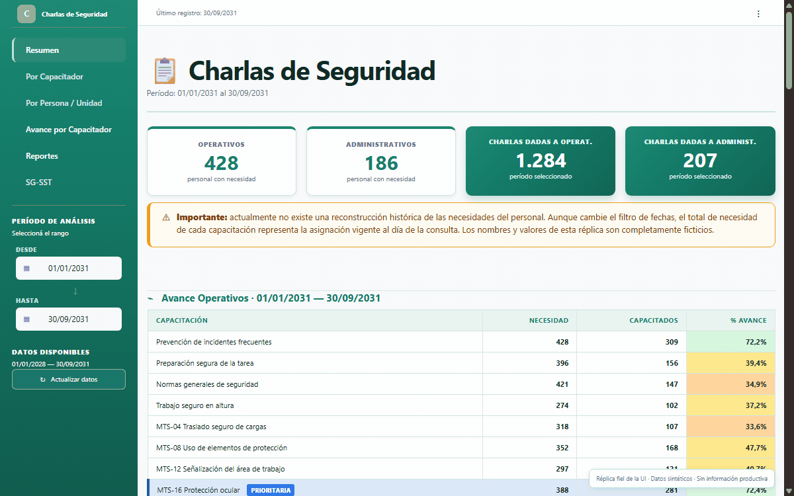
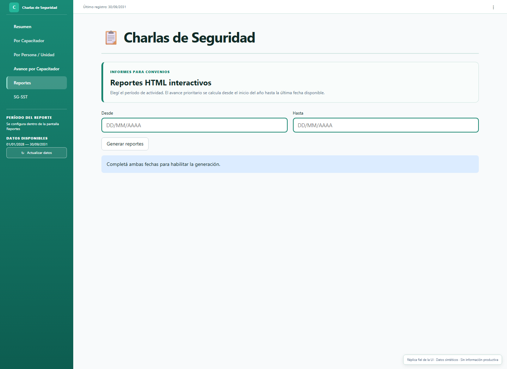

# Evolución del dashboard: navegación y reportes HTML

> **Demostración pública y sintética.** Todos los nombres, cifras, agrupaciones y registros son ficticios. El dashboard es una reconstrucción parcial; el reporte actual adapta el renderer y la tipografía de la solución con datos generados para la demo, sin utilizar registros productivos.

## Contexto del proyecto

Un **coloquio** es una instancia breve de capacitación sobre un contenido de seguridad. No todas las personas necesitan completar los mismos contenidos: la necesidad depende del puesto, de las tareas que realizan y del departamento al que pertenecen. Algunos contenidos se definen como prioritarios para concentrar el seguimiento durante una etapa del año.

El panel permite comparar esas necesidades con las capacitaciones registradas. De esa comparación surgen el porcentaje de avance del programa, el detalle de las personas que todavía tienen contenidos pendientes y el seguimiento de la cantidad y el avance de las actividades realizadas por cada capacitador.

En resumen, el panel permite:
- Cantidad de personas que requieren cada capacitación.
- Personas capacitadas, pendientes y porcentaje de avance.
- Comparaciones por capacitación, gerencia, zona, organización y reparto.
- Seguimiento de capacitaciones prioritarias.
- Actividad histórica de capacitadores.
- Evolución mensual de las capacitaciones realizadas.
- Situación particular de una persona mediante su número de identificación interno.
- Detalle nominal de personas que todavía tienen capacitaciones pendientes.
- Cobertura y cumplimiento de capacitaciones obligatorias de SG-SST.

En este caso utilizo dos términos que conviene distinguir:

- **Capacitador responsable:** tiene asignado un universo de personas y contenidos sobre el que debe hacer seguimiento.
- **Capacitador que dictó:** es quien figura en el registro de una capacitación realizada. Puede coincidir o no con el responsable del universo. Por ejemplo, una persona puede estar asignada al capacitador responsable A, pero la capacitación puede haber sido dictada por el capacitador B. Para el avance del programa importa que la persona haya cumplido el contenido; ambos roles se conservan para poder analizar responsabilidades y actividad efectiva.

Esta es la segunda etapa del [caso de seguimiento de coloquios](../). La primera reemplazó un proceso basado en Excel y Power Query por una base SQLite y un dashboard en Streamlit. Esta actualización responde a dos problemas que aparecieron con el uso cotidiano: se incorporaba información necesaria para tomar decisiones, pero esa información se iba agregando en lugares poco integrados; y la interfaz acumulaba cada vez más contenido en pantallas extensas. Como consecuencia, el tablero se volvía más lento de recorrer y a las personas menos familiarizadas con herramientas informáticas les costaba encontrar el análisis que necesitaban.

Mientras GitHub Pages no está configurado, las reconstrucciones pueden consultarse como archivos fuente dentro del repositorio:

- [Fuente de la réplica del dashboard](./demo/dashboard.html)
- [Fuente del reporte HTML interactivo](./demo/index.html)

También está disponible el [reporte HTML actual interactivo](./demo/reporte-actual.html), con datos ficticios. Las versiones anteriores se conservan para comparación.

## Qué cambió

| Antes | Problema | Ahora | Solución aportada |
|---|---|---|---|
| **Navegación del dashboard.** Una misma pantalla se extendía verticalmente y contenía indicadores, filtros, gráficos, tablas, mapas de calor y listados. Los componentes estaban separados por títulos, pero aparecían uno debajo del otro dentro de una página larga. | Si una persona necesitaba consultar un solo gráfico o un mapa de calor, tenía que desplazarse a través de todos los bloques anteriores hasta encontrarlo. Parte del contenido no era relevante para su consulta. Además, cuando se agregaba o modificaba un componente, los bloques siguientes cambiaban de posición y quienes usaban el tablero dejaban de encontrarlos donde estaban acostumbrados. | El menú lateral separa las preguntas principales en **pantallas**. Dentro de cada pantalla, controles segmentados permiten elegir una **sección** que contiene uno o dos componentes relacionados entre sí. | La navegación se volvió predecible: primero se elige el tipo de consulta y después el análisis puntual. En Streamlit, la selección también permite ejecutar la preparación específica de la sección elegida en lugar de calcular todos los análisis de la pantalla en cada actualización. |
| **Reporte semanal.** Dos coordinadores preparaban el reporte del avance del programa y el seguimiento de aproximadamente 30 capacitadores. Descargaban archivos PNG generados por el tablero, extraían CSV, tomaban otras capturas con la herramienta de recortes y preparaban archivos Excel con los pendientes de cada capacitador. | Al haber un solo filtro de fechas que impactaba todo el tablero, para preparar los extractos había que configurar fechas y filtros varias veces, descargar archivos separados, comprobar que todos correspondieran al mismo período y reunirlos manualmente. Un filtro mal aplicado podía hacer que una parte del reporte no coincidiera con el resto. El material tampoco ofrecía en un único lugar el panorama general para jefaturas, la actividad del período y el detalle operativo de cada capacitador. | Desde la pantalla `Reportes`, cada coordinador selecciona una única vez las fechas de actividad. El sistema consulta la base y genera dos HTML autocontenidos: uno para `Grupo A` y otro para `Grupo B`, con aproximadamente 15 capacitadores en cada uno. | Cada archivo reúne el avance general del programa anual, el detalle del grupo correspondiente, la actividad del período y todos los pendientes. Las cifras provienen directamente de las mismas fuentes y reglas del tablero. La generación reemplaza el armado manual y mantiene la revisión y el envío bajo control humano. |

## El problema de navegación anterior

El crecimiento del dashboard era útil desde el punto de vista funcional: cada nuevo gráfico, tabla o mapa respondía una consulta real. El problema era que la interfaz seguía creciendo hacia abajo. Dentro de `Resumen`, por ejemplo, podían convivir los indicadores generales, el avance por capacitación, las prioridades por capacitador, comparaciones por gerencia y zona, mapas de calor y listados operativos.

Los títulos ayudaban a separar visualmente cada bloque, pero no resolvían la navegación. Para llegar a una visualización ubicada al final había que atravesar todas las anteriores. Al actualizar el tablero o incorporar un nuevo análisis, el desplazamiento necesario cambiaba y los elementos dejaban de ocupar una ubicación estable.

La siguiente animación es una **reconstrucción sintética del funcionamiento anterior**. No es una grabación del entorno productivo: utiliza datos ficticios y apila los componentes para mostrar el recorrido que exigía una sola pantalla.



## Pantallas y secciones

Reorganicé la interfaz en dos niveles:

- Una **pantalla** representa una pregunta principal y se elige desde el menú lateral. `Resumen` y `Avance por Capacitador` son dos ejemplos.
- Una **sección** representa un análisis puntual dentro de una pantalla. Se selecciona mediante un control horizontal y muestra sólo los componentes relacionados con esa consulta.

La separación no es solamente visual. La versión productiva utiliza navegación condicional con `st.radio` y `st.segmented_control`. Los indicadores generales compartidos por una pantalla siguen calculándose una vez, pero las consultas y transformaciones específicas de las secciones inactivas no se ejecutan hasta que el usuario las elige. Esto evitó el comportamiento anterior de las pestañas de Streamlit, que preparaban contenido que todavía no se estaba consultando.

### Resumen

`Resumen` conserva los indicadores generales del programa y permite cambiar entre análisis como el avance por capacitación y las prioridades por capacitador. En lugar de apilar todas las tablas y gráficos, el área principal se reemplaza cuando cambia la sección.


La sección de prioridades conserva la distinción operativa entre `Convenio A` y `Convenio B`, presenta sus indicadores agregados y compara el avance ponderado de los capacitadores responsables.


### Avance por Capacitador

Esta pantalla permite seleccionar un capacitador responsable y consultar el universo que tiene asignado. Sus secciones separan el avance por contenido, el desglose por organización y las personas que todavía tienen capacitaciones pendientes.

La información sirve para acompañar el trabajo de capacitación y señalar tareas pendientes, pero no pretende medir por sí sola la calidad o efectividad profesional de una persona. Los capacitadores también realizan otras tareas que no forman parte de estos indicadores.


La réplica pública implementa estos flujos seleccionados con información sintética. No reproduce las seis pantallas ni todas las variantes administrativas del sistema productivo.

### Evolución visual: menos es más

Además de reorganizar la navegación, revisé la jerarquía visual de los componentes. Una métrica puede ser medible sin ser necesaria en una pantalla de uso diario: si nadie la consulta, ocupa espacio y obliga a las personas a recorrer más información para encontrar lo importante.

La interfaz actual agrupa indicadores relacionados, incorpora el avance en las tarjetas de cada universo y reúne título, explicación, leyenda y tabla en componentes más fáciles de leer. La navegación lateral es más compacta. La antigua pantalla `Por Inspector` dejó de ser una pantalla independiente: su información útil se integró como `Actividad histórica` en `Avance por Inspector`, separando lo que una persona dictó de la responsabilidad sobre el universo que tiene asignado.

| Antes: reconstrucción anterior | Después: reconstrucción actual |
|---|---|
|  |  |
|  |  |

Las imágenes anteriores son reconstrucciones sintéticas. Las imágenes actuales fueron generadas con los componentes y estilos de Streamlit de la solución, alimentados con datos ficticios; no contienen datos del tablero productivo. Los valores de ambos momentos son diferentes: la comparación muestra cambios de interfaz, no de resultados del programa.

La [tabla completa de prioridades](./assets/dashboard-prioridades-tabla-completa.png) muestra 24 inspectores ficticios y el total ponderado de ambos grupos.


## Cómo se preparaba el seguimiento semanal

El seguimiento está dividido entre dos coordinadores y dos grupos. Cada coordinador trabaja con aproximadamente 15 capacitadores de `Grupo A` o `Grupo B`. La separación responde a la organización operativa del programa, pero ese criterio no es necesario para comprender la solución técnica.

Antes de esta actualización, preparar el material implicaba combinar distintas salidas:

1. Configurar el período de consulta dentro del dashboard.
2. Descargar PNG que resumían el avance general y los contenidos prioritarios.
3. Descargar CSV con personas y capacitaciones pendientes.
4. Tomar capturas de otros componentes que no formaban parte de los PNG exportables.
5. Organizar parte de la información en un Excel consolidado.
6. Preparar, cuando se solicitaba, un CSV o detalle específico para un capacitador.
7. Revisar que las fechas y filtros utilizados en cada archivo coincidieran antes de enviarlos.

Los archivos cumplían objetivos diferentes. Los PNG y las capturas mostraban la situación general o una comparación visual; los CSV contenían el detalle nominal necesario para saber a qué personas debía capacitar cada responsable y en qué contenidos; el Excel se utilizaba para reunir y distribuir parte de ese material.

El proceso completo demandaba aproximadamente una hora semanal entre ambos coordinadores. Es una estimación: podía variar según la cantidad de archivos individuales solicitados y no existía una medición formal. El principal problema no era solamente el tiempo, sino también la posibilidad de aplicar fechas distintas, omitir un archivo o distribuir información que no coincidiera con el resto del paquete.

## Qué genera ahora el sistema

Desde la pantalla `Reportes`, el coordinador ingresa una fecha inicial y una fecha final para definir el período de actividad que quiere revisar. Habitualmente se utiliza una ventana semanal, pero las fechas son libres: permiten contemplar un envío atrasado, un feriado o la preparación de un informe mensual sin cambiar la lógica del reporte. Con ese período se generan dos documentos, uno para cada grupo de seguimiento.



Cada HTML combina dos ventanas temporales distintas:

- **Actividad del período:** utiliza exactamente las fechas elegidas y representa el avance semanal, mensual o del intervalo que se quiera informar. Cuenta las capacitaciones efectivamente realizadas, es decir, los registros persona-capacitación que se concretaron dentro de esas fechas. Ordena de mayor a menor la cantidad de capacitaciones dictadas por cada capacitador que figura como quien realizó la actividad, ordena las capacitaciones más dictadas y muestra, mediante tooltips, cuánto aportó cada capacitador a cada contenido. También identifica a quienes no tuvieron actividad en el período.
- **Avance del programa y pendientes:** muestra el avance anual de las capacitaciones prioritarias y del resto del programa, tomando como fecha de corte la última fecha disponible del año de seguimiento. El apartado de pendientes permite elegir entre ver sólo los contenidos prioritarios o todas las capacitaciones pendientes del universo del capacitador responsable. No es un promedio de la actividad semanal: es el estado acumulado del programa y de las obligaciones que todavía faltan completar.

Los dos documentos comparten el mismo resumen agregado del programa, que contempla a los aproximadamente 30 capacitadores. Después, cada archivo muestra únicamente el detalle del grupo correspondiente a su coordinador: cerca de 15 capacitadores, sus indicadores y sus pendientes nominales. Un grupo no recibe el detalle individual del otro, aunque ambos ven el mismo panorama agregado.

Todos los integrantes de un grupo, el coordinador y las jefaturas destinatarias reciben el mismo HTML de ese grupo. Esta distribución es intencional y forma parte del funcionamiento definido para el programa.

## Qué contiene el reporte HTML

El documento reúne información que antes estaba distribuida entre varias pantallas, secciones y descargas:

- Avance acumulado de las capacitaciones prioritarias del primer y segundo semestre.
- Totales de personas capacitadas, necesidades y porcentaje ponderado.
- Comparación del avance prioritario por capacitador responsable.
- Actividad realizada dentro de las fechas elegidas, normalmente utilizada como avance semanal, pero adaptable a otros intervalos.
- Cantidad de capacitaciones efectivamente realizadas por cada capacitador que dictó actividades, ordenada de mayor a menor.
- Distribución de esa actividad por contenido de capacitación, con tooltips que detallan cuánto aportó cada capacitador.
- Separación de los contenidos entre capacitaciones operativas y administrativas.
- Listado final con todas las capacitaciones dictadas en el período, no sólo las que fueron definidas como prioritarias.
- Inclusión de capacitadores sin actividad durante el período, para que la ausencia de registros también sea visible.
- Personas y contenidos que continúan pendientes para cada capacitador responsable.
- Filtro para mostrar todas las capacitaciones operativas pendientes o sólo las prioritarias de un semestre.
- Descarga CSV del detalle que está visible después de aplicar los filtros.
- Tooltips que explican el significado y la fórmula de los indicadores.
- Notas metodológicas sobre asignaciones, alcance y motivos por los que los porcentajes pueden cambiar.

El listado de pendientes se obtiene cruzando el universo vigente de necesidades, la asignación actual de cada persona a un capacitador y las capacitaciones registradas durante el período acumulado. El resultado no es una lista cargada manualmente: se calcula a partir de las vistas y registros de la base.

La tabla de pendientes permite seleccionar un capacitador responsable, alternar entre contenidos prioritarios y el universo operativo completo, y descargar el detalle visible.

El reporte también recibió la nueva tipografía y componentes agrupados. La versión actual conserva el filtro de pendientes por `Todos`, `1er semestre` y `2do semestre`, además de la descarga CSV del resultado visible.

Podés consultar el [reporte HTML actual interactivo](./demo/reporte-actual.html) para explorar directamente sus indicadores, filtros y descarga CSV.

## Por qué elegí un HTML autocontenido

El HTML permite reunir información para distintas audiencias dentro de un único archivo. Una jefatura puede comenzar por el panorama general; un coordinador puede revisar la actividad y comparar avances; un capacitador puede filtrar su nombre y consultar las personas que todavía tiene pendientes.

Frente al conjunto anterior de PNG, capturas, CSV y Excel, el formato aporta:

- Un único archivo por grupo.
- Apertura local en cualquier navegador, sin instalar Python ni conectarse al dashboard.
- Diseño adaptable para computadoras y teléfonos.
- Mejor control visual que una planilla utilizada como informe.
- Más interacción que un documento estático como PDF.
- Filtros, tooltips y descarga CSV sin conexión a un servidor.

El documento incluye su estructura, estilos, datos e interacción. Python realiza las cargas y calcula los indicadores antes de generar el archivo. El reporte comparte con el dashboard la base, los universos cacheados y el cálculo del resumen general; para la actividad, el detalle prioritario y los pendientes utiliza cargas específicas. De esta manera, las reglas centrales se mantienen unificadas sin presentar como reutilizados en memoria resultados que pertenecen a otra pantalla. JavaScript no redefine las reglas de negocio: se limita a cambiar paneles visibles, abrir ayudas, filtrar información ya calculada y construir el CSV local.

## Una salida controlada y trazable en lugar de un reporte generado de forma ad hoc

Una alternativa posible, previa a esta solución, era entregar a una herramienta de IA los PNG, las capturas, los CSV y el Excel para pedirle que armara un reporte. Decidí anticiparme porque una generación de ese tipo podía modificar cifras, nombres, colores o criterios, o producir conclusiones que después no fueran controladas de manera consistente.

El reporte actual no interpreta libremente los extractos. Consume fuentes y resultados calculados mediante reglas definidas en código, y mantiene alineado el resumen general con el dashboard. Para un mismo estado de las fuentes, configuración y fechas, produce los mismos indicadores, aunque el archivo conserve metadatos propios de cada generación. La revisión y el envío siguen siendo decisiones humanas.

Esa alternativa podía generar problemas de confianza y retrabajo: si un avance se informaba de forma incorrecta, los capacitadores podían cuestionar el resultado y los coordinadores debían reconstruir por qué el reporte no coincidía con otros tableros ya enviados. Por eso opté por una salida calculada con reglas conocidas, fuentes trazables y un formato común.

El reporte también mejora el control cruzado. Antes, algunos detalles podían omitirse de los informes enviados a los capacitadores porque una inconsistencia podía generar confusión y reclamos. Ahora los capacitadores reciben el detalle necesario para revisar sus propios pendientes y detectar registros faltantes o diferencias. Como los coordinadores cargan los datos mediante otro desarrollo del mismo proceso, esta visibilidad permite detectar errores u omisiones de carga y revisar también la calidad del trabajo de data entry. El resultado es una comprensión compartida del estado del programa y una oportunidad concreta para pulir los datos antes de que las inconsistencias se acumulen.

## Evolución técnica de la solución

La primera versión concentraba gran parte de la orquestación en la aplicación principal. A medida que se incorporaron consultas, pantallas y exportaciones, esa estructura generó llamadas repetidas, componentes duplicados y más trabajo del necesario durante cada actualización de Streamlit.

La arquitectura actual es modular, pero no está dividida en capas completamente independientes. `app.py` continúa siendo el punto de entrada y coordina varias pantallas; las pantallas de avance por capacitador y reportes coordinan además sus propios recorridos de carga, cálculo y presentación.

```text
charla5min/
├── app.py                         # Entrada, navegación y orquestación
├── config/
│   ├── settings.py                # Configuración y constantes de negocio
│   └── styles.py                  # Estilos globales de Streamlit
├── database/
│   ├── connection.py              # Conexión SQLite de sólo lectura
│   ├── contracts.py               # Contratos de DataFrames
│   ├── loaders.py                 # SQL, caché, normalización y cruces
│   └── report_loaders.py          # Cargas específicas de reporting
├── services/
│   ├── avance_service.py          # Avance general y prioridades
│   ├── avance_inspector_service.py # Avance, detalle y pendientes
│   └── report_service.py          # Modelo de datos del reporte
├── ui/
│   ├── cards.py / navegacion.py / sidebar.py / tables.py
│   └── screens/
│       ├── resumen.py
│       ├── por_inspector.py
│       ├── persona_reparto.py
│       ├── avance_inspector.py
│       ├── reportes.py
│       └── sg_sst.py
├── reports/
│   └── export_html.py             # Renderer HTML, CSS y JavaScript
├── tests/
└── tools/                         # Capturas y baselines de caracterización
```

El recorrido de datos parte de SQLite y sus vistas, pasa por los loaders generales o específicos de reporting, y utiliza servicios puros para los cálculos principales. El dashboard termina en componentes Streamlit; el reporte pasa por `report_service.py` y `export_html.py` para producir dos HTML autocontenidos con sus datos, estilos e interacción local. Los loaders de reporting reutilizan algunos loaders generales y universos cacheados, pero también realizan cargas propias para la actividad, el detalle prioritario y los pendientes.

La evolución permitió reducir trabajo repetido en algunos recorridos, reutilizar resultados cacheados y ejecutar cálculos específicos sólo cuando se selecciona la sección correspondiente. No publico un benchmark de rendimiento porque no se realizó una medición controlada antes y después.

## Cómo preservé las reglas de cálculo

La reorganización visual y el nuevo formato no debían producir indicadores diferentes. Para evitarlo:

- El resumen general del dashboard y el reporte reutilizan las mismas fuentes y funciones de cálculo del avance.
- El reporte utiliza loaders específicos para actividad, detalle prioritario y pendientes, pero mantiene sus reglas de transformación en servicios reutilizables.
- Hay pruebas automatizadas sobre navegación, servicios, contratos de DataFrames, filtros y generación del HTML.
- El renderer se prueba con datos sintéticos para verificar estructura, contenido, escape de valores e interacción.
- Realizo auditorías ocasionales comparando el HTML generado con las pantallas equivalentes del dashboard.

El feedback de las primeras revisiones también produjo cambios visibles. Se agregaron tooltips para explicar qué mide cada indicador y notas metodológicas al final del documento para aclarar por qué una modificación de necesidades, licencias, traslados o asignaciones puede cambiar los porcentajes.

## Mi participación

La necesidad no surgió de un único pedido formal. Distintas personas plantearon problemas parciales: agrupar CSV, reunir componentes para no enviar capturas separadas y reducir el tiempo perdido preparando el reporte. También señalaron errores derivados de configurar manualmente los filtros de fecha varias veces.

A partir de esos pedidos diseñé e implementé individualmente la reorganización de la navegación, las optimizaciones de consultas, el modelo de reporting y el renderer HTML. Los coordinadores aportaron el contexto operativo y el feedback necesario para ajustar la salida a la forma en que realizan el seguimiento.

## Adopción inicial

Los dos coordinadores utilizan los reportes semanalmente desde hace dos semanas. Durante este período inicial, la generación y el primer control contra el dashboard no demandaron más de aproximadamente cinco minutos por ciclo.

La comparación con la hora semanal del proceso anterior debe leerse como una estimación operativa temprana, no como un estudio formal de ahorro. Todavía no existe una ventana de observación suficiente para afirmar un resultado sostenido de largo plazo.


## Próximo avance

La interfaz operativa sigue construida en Streamlit. Existe en otro repositorio un primer borrador de migración hacia React y TypeScript con FastAPI como backend.

El objetivo no es cambiar de tecnología por sí mismo. Streamlit permitió entregar rápidamente una herramienta útil, pero ofrece menos control sobre el layout y utiliza un modelo de ejecución basado en reruns. Una separación más explícita entre frontend y API permitiría construir interacciones más flexibles, controlar mejor la experiencia visual y evolucionar la interfaz sin volver a implementar las reglas que ya fueron validadas.

## Alcance y privacidad

Este caso excluye nombres de empresa, personas, ubicaciones, correos, rutas, métricas productivas y reglas o consultas SQL corporativas. Las demos, capturas y animaciones utilizan información ficticia y no fueron construidas a partir de una copia anonimizada de la base real. El HTML de la demo actual adapta el renderer visual productivo con datos sintéticos y terminología pública.
