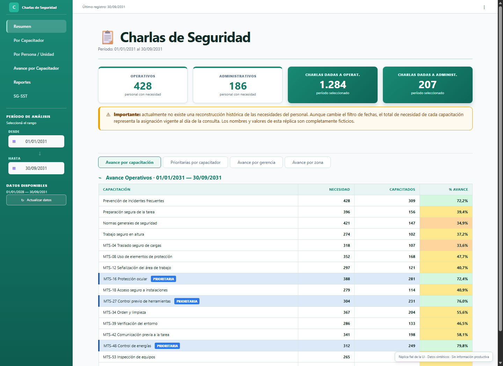
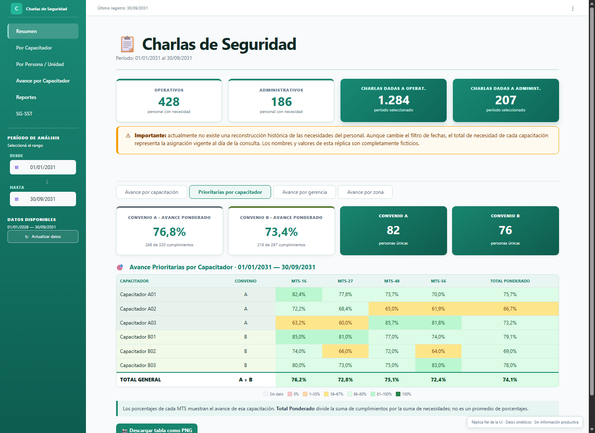
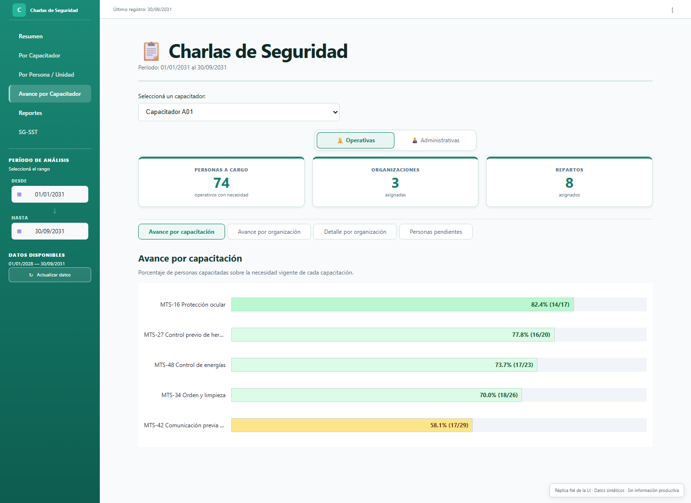

# Evolución del dashboard: navegación y reportes semanales

> **Aclaraciones** Todos los nombres, cifras, agrupaciones y registros son ficticios. Las demos conservan la disposición general y los patrones de interacción de la solución, pero fueron reconstruidas desde cero con otra paleta, sin capturas, código visual ni datos del entorno productivo.

Esta es la segunda etapa del [caso de seguimiento de coloquios](../). Un **coloquio** es una instancia breve de capacitación sobre seguridad. Cada persona tiene determinados contenidos requeridos, su **necesidad**, y los **capacitadores** registran las instancias realizadas.

La primera etapa reemplazó un seguimiento basado en Excel y Power Query por una base SQLite normalizada y un dashboard Streamlit. Con el uso, la herramienta sumó indicadores y tablas; algunas pantallas se hicieron extensas y el seguimiento semanal todavía exigía combinar varios archivos fuera del sistema.

## Qué cambió

- El dashboard se dividió en pantallas y subsecciones orientadas a preguntas concretas.
- Se conservaron los cálculos y reglas existentes, pero se redujo el contenido renderizado al análisis elegido.
- Se incorporaron dos reportes HTML semanales: uno para cada coordinador.
- Cada reporte reúne únicamente la información de los capacitadores asignados a ese coordinador.
- La preparación quedó automatizada; la revisión y el envío por correo continúan siendo manuales.

## Del armado manual a un único archivo

Antes, los dos coordinadores descargaban CSV, PNG y capturas, separaban pendientes por capacitador y organizaban la información hoja por hoja en Excel. Luego preparaban múltiples archivos para sus capacitadores, sus propios jefes y el jefe de los capacitadores. El trabajo combinado demandaba aproximadamente una hora semanal.

Ahora el flujo es:

1. Seleccionar el período de actividad correspondiente a la semana.
2. Ejecutar en Python las consultas y los cálculos reproducibles.
3. Generar dos reportes, uno por coordinador.
4. Descargar y revisar un único HTML integrado por coordinador.
5. Enviarlo manualmente a los capacitadores asignados, al jefe del coordinador y al jefe de los capacitadores.

La actividad respeta el período semanal seleccionado. El avance acumulado se calcula desde el inicio del año hasta la fecha de corte, de modo que el mismo documento combina situación general y movimiento reciente.

## Qué contiene cada reporte

- Avance acumulado de contenidos prioritarios.
- Actividad de la semana seleccionada.
- Comparación de prioridades.
- Detalle de avance por capacitador.
- Distribución de capacitaciones dictadas.
- Personas y capacitaciones pendientes.
- Filtros por capacitador y contenidos prioritarios.
- Descarga CSV del detalle visible.
- Notas breves sobre alcance y cálculo.

El HTML contiene sus estilos, datos e interacción. Puede abrirse localmente en un navegador sin instalar Python, conectarse a la base ni ingresar al dashboard.

## Demos navegables

- [Explorar el dashboard público](https://jminolli-e.github.io/case-studies/coloquios/actualizacion/demo/dashboard.html)
- [Abrir un reporte semanal de ejemplo](https://jminolli-e.github.io/case-studies/coloquios/actualizacion/demo/)

La réplica del dashboard implementa `Resumen` y `Avance por Capacitador`. Algunas pestañas se muestran deshabilitadas para comunicar la estructura sin simular funcionalidades que no forman parte de esta demostración. Los selectores, vistas de prioridades, mapa de calor, pendientes y tooltips utilizan datos sintéticos.

## Estado actual

La interfaz operativa actual está construida en Streamlit y prioriza la consulta, la trazabilidad y la utilidad diaria. La réplica pública utiliza HTML, CSS y JavaScript para ofrecer una muestra portable y visualmente diferenciada.

Existe una migración inicial hacia React, TypeScript y FastAPI. Todavía no reemplaza al dashboard actual ni reproduce toda su funcionalidad; una etapa futura buscará una experiencia visual más refinada sin perder las reglas ya validadas.

## Conceptos usados

<strong>Coloquio</strong>

Instancia breve de capacitación sobre un contenido de seguridad.

<strong>Necesidad</strong>

Contenido que una persona debe completar según su perfil y asignación organizativa vigente.

<strong>Capacitador</strong>

Persona que dicta coloquios y consulta el avance y los pendientes de las personas que tiene asignadas.

<strong>Coordinador</strong>

Persona que supervisa un grupo de capacitadores, revisa su reporte semanal y controla su distribución manual.

## Alcance y privacidad

La hora semanal describe el costo aproximado del proceso anterior, no una medición de ahorro validada después del despliegue. La necesidad histórica continúa calculándose con la asignación vigente, una limitación documentada desde la primera etapa.

Este caso excluye nombres de empresa, personas, ubicaciones, correos, rutas, métricas productivas y código fuente corporativo. Las demos no fueron construidas a partir de una copia anonimizada de la base real.
